# Sprintive AI Agents & Pipeline Architecture

## 1. Overview

Sprintive transforms raw meeting audio transcripts into structured executive summaries and production-ready Scrum/Kanban work items. 

The architecture enforces strict boundaries between **transcript hygiene**, **high-level meeting intelligence**, **Scrum backlog generation**, and **deterministic entity resolution**.

```
RAW TRANSCRIPT
      │
      ▼
┌────────────────────────────────────────────────────────┐
│   14-Stage Transcript Cleaning & Validation Pipeline   │
└────────────────────────────────────────────────────────┘
      │
      ▼  (CLEANED TRANSCRIPT)
┌────────────────────────────────────────────────────────┐
│   Stage 1: Main Meeting Analysis Agent (LLM)           │
└────────────────────────────────────────────────────────┘
      │
      ▼  (MeetingAnalysisResult)
┌────────────────────────────────────────────────────────┐
│   Stage 2: Scrum Intelligence Agent (LLM)              │
└────────────────────────────────────────────────────────┘
      │
      ▼  (ScrumResult)
┌────────────────────────────────────────────────────────┐
│   Stage 3: Deterministic Task Resolution (Rule Engine) │
└────────────────────────────────────────────────────────┘
      │
      ▼  (ResolvedTasks)
DATABASE / KANBAN BACKLOG
```

---

## 2. End-to-End System Flow Diagram

```mermaid
sequenceDiagram
    autonumber
    actor Client as Frontend / User
    participant Orch as Transcript Orchestrator
    participant Storage as Supabase Storage
    participant Clean as 14-Stage Cleaner
    participant Agent1 as Main Meeting Agent
    participant Agent2 as Scrum Intelligence Agent
    participant Res as Task Resolution Service
    participant Backend as Backend / Database

    Client->>Orch: POST /transcript/process (or /ai-analyze)
    Orch->>Storage: Download raw transcript (.txt)
    Orch->>Clean: Execute 14-Stage Cleaning & Normalization
    Clean-->>Orch: Cleaned UTF-8 Transcript
    Orch->>Storage: Store cleaned transcript & metadata
    
    rect rgb(30, 45, 60)
        note over Orch, Agent1: Stage 1: Meeting Understanding
        Orch->>Agent1: analyze_transcript(cleaned_text)
        Agent1-->>Orch: MeetingAnalysisResult (Summary, Topics, Decisions, Actions, Blockers)
    end

    rect rgb(45, 30, 60)
        note over Orch, Agent2: Stage 2: Backlog Generation
        Orch->>Agent2: analyze(meeting_analysis)
        Agent2-->>Orch: ScrumResult (Scrum Tasks, Acceptance Criteria, Estimates)
    end

    rect rgb(30, 60, 45)
        note over Orch, Res: Stage 3: Deterministic Post-Processing
        Orch->>Res: resolve_tasks(scrum_result, team_members, timestamp)
        Res-->>Orch: ResolvedTasks (UUID IDs, User IDs, ISO Due Dates)
    end

    Orch-->>Backend: MeetingAIPipelineResponse
    Backend-->>Client: Final Meeting Summary + Actionable Kanban Tasks
```



---

## 3. Pipeline Stages & Agent Specifications

### Pre-Agent: The 14-Stage Transcript Cleaning Pipeline
*Orchestrated by [`TranscriptProcessingOrchestrator`](file:///c:/Users/krish/Desktop/Sprintive/transcript-processing-service/app/services/transcript_orchestrator.py)*

Before LLM agents process the meeting, raw Speech-To-Text (STT) segments pass through 14 deterministic and heuristic filters:

1. **Transcript Parsing**: Validates timestamps and speaker tags ([`transcript_parser.py`](file:///c:/Users/krish/Desktop/Sprintive/transcript-processing-service/app/services/transcript_parser.py))
2. **Noise & Filler Detection**: Removes "um", "uh", audio coughs, and stutter artifacts ([`noise_detector.py`](file:///c:/Users/krish/Desktop/Sprintive/transcript-processing-service/app/services/noise_detector.py))
3. **Repetition Removal**: Deduplicates consecutive repeated words and loops ([`repetition_remover.py`](file:///c:/Users/krish/Desktop/Sprintive/transcript-processing-service/app/services/repetition_remover.py))
4. **Relevance Filtering**: Prunes pre-meeting banter and irrelevant small talk ([`relevance_filter.py`](file:///c:/Users/krish/Desktop/Sprintive/transcript-processing-service/app/services/relevance_filter.py))
5. **Sentence Segmentation & Merging**: Recombines fragmented utterances ([`fragment_merger.py`](file:///c:/Users/krish/Desktop/Sprintive/transcript-processing-service/app/services/fragment_merger.py))
6. **STT Correction**: Repairs common phonetic transcription mistakes ([`stt_corrector.py`](file:///c:/Users/krish/Desktop/Sprintive/transcript-processing-service/app/services/stt_corrector.py))
7. **Grammar & Punctuation**: Standardizes casing, commas, and terminal periods ([`grammar_normalizer.py`](file:///c:/Users/krish/Desktop/Sprintive/transcript-processing-service/app/services/grammar_normalizer.py))
8. **Terminology Normalization**: Maps software/engineering domain terms (e.g., "cube nettees" -> "Kubernetes") ([`terminology_normalizer.py`](file:///c:/Users/krish/Desktop/Sprintive/transcript-processing-service/app/services/terminology_normalizer.py))
9. **Contextual Validation**: Detects contradictory temporal references ([`contextual_validator.py`](file:///c:/Users/krish/Desktop/Sprintive/transcript-processing-service/app/services/contextual_validator.py))
10. **Speaker Attribution**: Validates turn-taking and speaker tags ([`speaker_validator.py`](file:///c:/Users/krish/Desktop/Sprintive/transcript-processing-service/app/services/speaker_validator.py))
11. **Language Preservation**: Asserts target language consistency ([`language_validator.py`](file:///c:/Users/krish/Desktop/Sprintive/transcript-processing-service/app/services/language_validator.py))
12. **Semantic Preservation**: Verifies semantic integrity between raw and cleaned text ([`semantic_validator.py`](file:///c:/Users/krish/Desktop/Sprintive/transcript-processing-service/app/services/semantic_validator.py))
13. **Final Formatting**: Produces clean text and markdown artifacts ([`transcript_formatter.py`](file:///c:/Users/krish/Desktop/Sprintive/transcript-processing-service/app/services/transcript_formatter.py))
14. **Storage Persistence**: Uploads output to Supabase Storage ([`storage_service.py`](file:///c:/Users/krish/Desktop/Sprintive/transcript-processing-service/app/services/storage_service.py))

---

### Agent Stage 1: Main Meeting Analysis Agent
*Implementation: [`MainMeetingAgent`](file:///c:/Users/krish/Desktop/Sprintive/transcript-processing-service/app/services/meeting_agent.py) | Prompts: [`app/prompts/meeting_agent.py`](file:///c:/Users/krish/Desktop/Sprintive/transcript-processing-service/app/prompts/meeting_agent.py)*

* **Goal**: High-level semantic comprehension of the full meeting transcript.
* **Input**: Decoded UTF-8 string of the cleaned transcript.
* **Key Directives**:
  * Keep transcript strictly within user prompt; system prompt enforces analytical role.
  * Extract factual context without hallucination.
* **Output Contract**: [`MeetingAnalysisResult`](file:///c:/Users/krish/Desktop/Sprintive/transcript-processing-service/app/models/meeting_agent.py)

```json
{
  "summary": "Executive summary of the discussion...",
  "topics": ["Sprint 24 Planning", "Database Migration", "CI/CD Flakiness"],
  "decisions": ["Adopt PostgreSQL partitioned tables for audit logs"],
  "action_items": [
    "Alex to draft migration script by Friday",
    "Sarah to investigate GitHub Actions runner timeouts"
  ],
  "blockers": ["Waiting on staging environment credentials from DevOps"]
}
```

---

### Agent Stage 2: Scrum Intelligence Agent
*Implementation: [`ScrumIntelligenceAgent`](file:///c:/Users/krish/Desktop/Sprintive/transcript-processing-service/app/services/scrum_agent.py) | Prompts: [`app/prompts/scrum_agent.py`](file:///c:/Users/krish/Desktop/Sprintive/transcript-processing-service/app/prompts/scrum_agent.py)*

* **Goal**: Convert meeting decisions and action items into formalized Agile/Kanban tickets.
* **Input**: [`MeetingAnalysisResult`](file:///c:/Users/krish/Desktop/Sprintive/transcript-processing-service/app/models/meeting_agent.py) *(Strict boundary: never receives raw transcript)*.
* **Key Directives**:
  * Grounded exclusively in the analysis output from Stage 1.
  * Retains source action item text for end-to-end traceability (`source_action_item`).
  * Emits `null` for unknown assignees or deadlines rather than inventing them.
* **Output Contract**: [`ScrumResult`](file:///c:/Users/krish/Desktop/Sprintive/transcript-processing-service/app/models/scrum_agent.py) containing a list of `ScrumTask`:

```json
{
  "meeting_id": "meeting-uuid-123",
  "tasks": [
    {
      "title": "Draft database migration script",
      "description": "Create PostgreSQL partitioned table migration script for audit logs.",
      "task_type": "task",
      "priority": "high",
      "assignee": "Alex",
      "deadline": "Friday",
      "source_action_item": "Alex to draft migration script by Friday",
      "acceptance_criteria": [
        "Script runs idempotently",
        "Rollback script included"
      ]
    }
  ]
}
```

---

### Stage 3: Deterministic Task Resolution (Rule Engine)
*Implementation: [`TaskResolutionService`](file:///c:/Users/krish/Desktop/Sprintive/transcript-processing-service/app/services/task_resolution_service.py) (Python) & [`backend/.../task-resolution.service.js`](file:///c:/Users/krish/Desktop/Sprintive/backend/src/services/task-resolution/task-resolution.service.js) (Node.js)*

* **Goal**: Turn fuzzy LLM outputs into deterministic, relational database records without additional LLM calls.
* **Responsibilities**:
  1. **Deterministic Task ID Generation**:
     ```python
     # SHA-1 hash over meeting_id + task_key formatted as UUIDv4
     task_id = generate_deterministic_task_id(meeting_id, task.title)
     ```
  2. **3-Tier Assignee Matching**:
     * Pool 1: `meeting_participants`
     * Pool 2: `team_members`
     * Match hierarchy: Exact Full-Name $\rightarrow$ Exact First-Name $\rightarrow$ Token Substring.
     * *Ambiguity guard*: Returns `null` if more than one user matches.
  3. **Relative-to-Absolute Date Resolution**:
     * Converts relative deadlines ("Friday", "next Tuesday", "tomorrow", "in 2 days") against the `meeting_timestamp` timezone into absolute ISO 8601 timestamps (`2026-10-16T17:00:00Z`).
  4. **Enums & Priority Normalization**:
     * Enforces `low` | `medium` | `high` | `urgent`.
     * Defaults unresolved statuses to `todo` or `backlog`.

---

## 4. Execution Entry Points

### 1. Unified Pipeline Service
```python
# app/services/meeting_ai_pipeline.py
response = await run_meeting_ai_pipeline(
    meeting_id=meeting_id,
    run_scrum_agent=True,
    run_task_resolution=True,
    team_id=team_id,
    participants=participants,
    team_members=team_members,
)
```

### 2. HTTP Endpoints ([`transcript.py`](file:///c:/Users/krish/Desktop/Sprintive/transcript-processing-service/app/api/routes/transcript.py))
| Endpoint | Method | Input | Description |
|---|---|---|---|
| `/transcript/ai-analyze/{meeting_id}` | `POST` | `meeting_id`, query params | Runs Stage 1 $\rightarrow$ Stage 2 $\rightarrow$ Stage 3 on stored transcript |
| `/transcript/scrum-analyze` | `POST` | `MeetingAnalysisResult` (JSON) | Direct Stage 2 analysis on provided analysis object |
| `/transcript/process` | `POST` | `meeting_id`, `run_ai_pipeline=True` | Executes 14 cleaning stages, then automatically runs AI Pipeline |

---

## 5. Directory & File Reference

```
transcript-processing-service/app/
├── api/routes/
│   └── transcript.py               # REST endpoints for pipeline & agents
├── prompts/
│   ├── meeting_agent.py            # Stage 1 system & user prompt templates
│   └── scrum_agent.py              # Stage 2 Scrum extraction prompt templates
├── models/
│   ├── meeting_agent.py            # Pydantic models: MeetingAnalysisResult, AIPipelineResponse
│   ├── scrum_agent.py              # Pydantic models: ScrumResult, ScrumTask
│   └── resolved_task.py            # Pydantic models: ResolvedTask, TaskResolutionResult
└── services/
    ├── meeting_agent.py            # MainMeetingAgent service class
    ├── scrum_agent.py              # ScrumIntelligenceAgent service class
    ├── task_resolution_service.py   # Python deterministic TaskResolutionService
    ├── meeting_ai_pipeline.py      # Pipeline coordinator (Stage 1 -> Stage 2 -> Stage 3)
    └── transcript_orchestrator.py  # 14-stage transcript cleaner & AI pipeline invoker

backend/src/services/task-resolution/
└── task-resolution.service.js      # Backend Node.js deterministic task resolver
```
