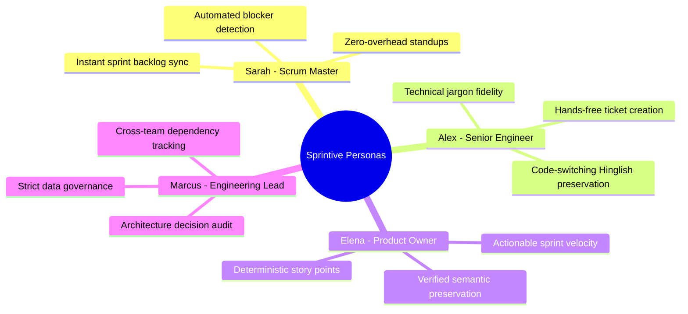
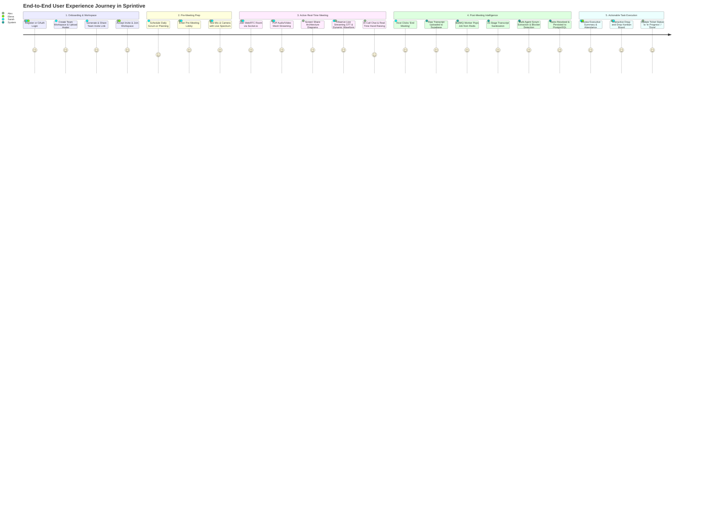
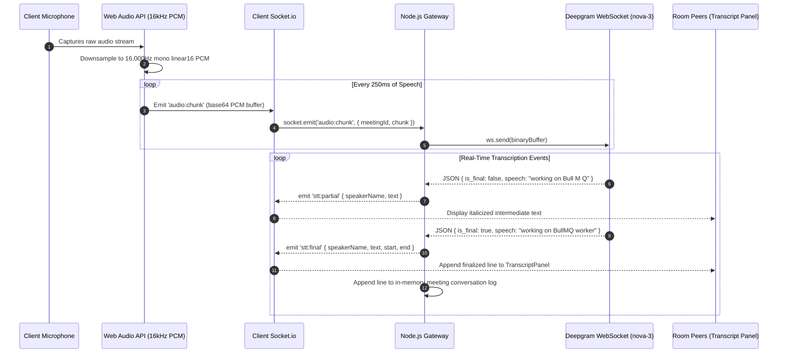
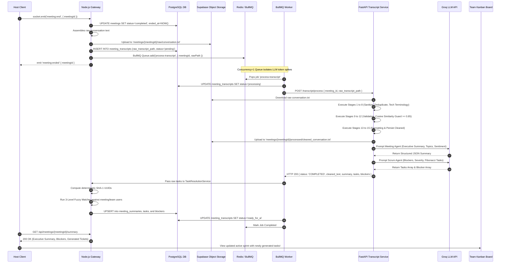
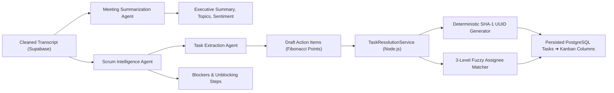
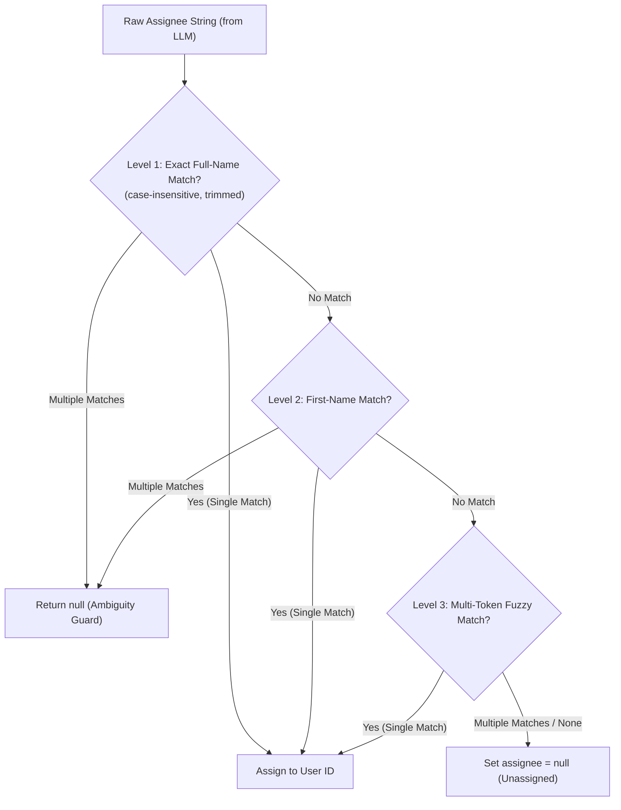
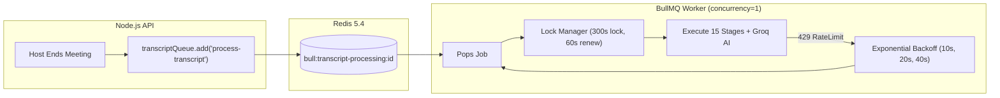

# 🚀 Sprintive (ScrumMind) — Comprehensive System Architecture & Engineering Specification

> **Version:** 2.0.0  
> **Target Audience:** Engineering Leads, System Architects, Developers, and DevOps  
> **Repository:** `Sprintive / ScrumMind`  
> **Document Status:** Authoritative System Specification & Architectural Reference  

---

## Table of Contents
1. [Executive Summary & Product Vision](#1-executive-summary--product-vision)
2. [User Personas & In-Depth User Narratives](#2-user-personas--in-depth-user-narratives)
3. [User Workflow, Journey & State Machine Diagrams](#3-user-workflow-journey--state-machine-diagrams)
4. [End-to-End System Architecture](#4-end-to-end-system-architecture)
5. [End-to-End Data Flow (Sequence Diagrams)](#5-end-to-end-data-flow-sequence-diagrams)
6. [Real-Time Meeting Subsystem Mechanics](#6-real-time-meeting-subsystem-mechanics)
   - [6.1 WebRTC Mesh Signaling Protocol](#61-webrtc-mesh-signaling-protocol)
   - [6.2 Video & Camera Controls](#62-video--camera-controls)
   - [6.3 Screen Sharing Pipeline & Track Replacement](#63-screen-sharing-pipeline--track-replacement)
   - [6.4 Dynamic Audio Spectrum Visualizer (Web Audio API)](#64-dynamic-audio-spectrum-visualizer-web-audio-api)
   - [6.5 Live Speech-to-Text Streaming Pipeline (Deepgram nova-3)](#65-live-speech-to-text-streaming-pipeline-deepgram-nova-3)
7. [The 15-Stage Transcript Processing Engine](#7-the-15-stage-transcript-processing-engine)
   - [7.1 Architectural Rationale & Pipeline Stages 1 to 15](#71-architectural-rationale--pipeline-stages-1-to-15)
   - [7.2 Mathematical & Semantic Guardrails](#72-mathematical--semantic-guardrails)
8. [Autonomous AI Scrum Agents & Task Resolution Engine](#8-autonomous-ai-scrum-agents--task-resolution-engine)
   - [8.1 Meeting Summarization Agent](#81-meeting-summarization-agent)
   - [8.2 Scrum Intelligence & Blocker Detection Agent](#82-scrum-intelligence--blocker-detection-agent)
   - [8.3 Task Extraction & Story Point Estimation Agent](#83-task-extraction--story-point-estimation-agent)
   - [8.4 Deterministic Task Resolution Engine (`TaskResolutionService`)](#84-deterministic-task-resolution-engine-taskresolutionservice)
9. [Asynchronous Background Processing: Redis, BullMQ & Worker Architecture](#9-asynchronous-background-processing-redis-bullmq--worker-architecture)
   - [9.1 Queue Configuration & Concurrency Isolation](#91-queue-configuration--concurrency-isolation)
   - [9.2 Lock Management & Heartbeats](#92-lock-management--heartbeats)
   - [9.3 Failure Handling, Exponential Backoff & 429 Interception](#93-failure-handling-exponential-backoff--429-interception)
   - [9.4 Worker Lifecycle & Graceful Shutdown](#94-worker-lifecycle--graceful-shutdown)
10. [Object Storage Architecture (Supabase Storage / S3)](#10-object-storage-architecture-supabase-storage--s3)
    - [10.1 Storage Bucket Hierarchy](#101-storage-bucket-hierarchy)
    - [10.2 Transcript Upload, Retrieval & Sync Lifecycle](#102-transcript-upload-retrieval--sync-lifecycle)
11. [External APIs, Execution Triggers & Call Frequencies](#11-external-apis-execution-triggers--call-frequencies)
    - [11.1 API Invocation Matrix & Frequency Audit](#111-api-invocation-matrix--frequency-audit)
    - [11.2 Rate Limiting & Quota Management Strategies](#112-rate-limiting--quota-management-strategies)
12. [Complete Internal API & WebSocket Protocol Documentation](#12-complete-internal-api--websocket-protocol-documentation)
    - [12.1 Authentication Endpoints (`/api/auth/*`)](#121-authentication-endpoints-apiauth)
    - [12.2 Team & Member Management Endpoints (`/api/teams/*`)](#122-team--member-management-endpoints-apiteams)
    - [12.3 Meeting Lifecycle Endpoints (`/api/meetings/*`)](#123-meeting-lifecycle-endpoints-apimeetings)
    - [12.4 Team Kanban & Ticket Endpoints (`/api/teams/:teamId/kanban/*`)](#124-team-kanban--ticket-endpoints-apiteamsteamidkanban)
    - [12.5 FastAPI Transcript Microservice Endpoints (`/transcript/*`)](#125-fastapi-transcript-microservice-endpoints-transcript)
    - [12.6 Real-Time Socket.io Event Protocol Catalog](#126-real-time-socketio-event-protocol-catalog)

---

## 1. Executive Summary & Product Vision

**Sprintive (ScrumMind)** is an enterprise-grade, AI-native Agile project management and meeting intelligence platform. It bridges the critical divide between **synchronous engineering discussions** (daily scrums, backlog grooming, architecture reviews) and **asynchronous task execution** (Kanban boards, backlog tracking, sprint velocity).

```
┌────────────────────────────────┐        ┌───────────────────────────────┐
│ Synchronous Engineering Voice   │ ────► │ Asynchronous Actionable Tasks │
│ (Noisy, Hinglish, Tech Jargon) │        │ (Deterministic, Tracked, Done)│
└────────────────────────────────┘        └───────────────────────────────┘
```

### The Problem Space
1. **Context Loss & Knowledge Drift:** Critical decisions, architecture trade-offs, and commitments voiced in calls disappear into the ether once participants disconnect.
2. **Speech-to-Text Noise in Tech Environments:** Out-of-the-box STT models fail miserably on code-switching (e.g. Hinglish: *"Main kal PostgreSQL connection pool optimize kar raha tha"*), stutters, filler words (`"um"`, `"uh"`), and specialized terminology (e.g., transcribing `PostgreSQL` as `"post gre SQL"`, `Kubernetes` as `"cube nettes"`).
3. **LLM Hallucinations on Raw Audio:** Feeding raw, unsegmented, noisy transcripts directly into Large Language Models creates fabricated user stories, incorrect assignees, phantom blockers, and runaway token expenses.
4. **Scrum Overhead:** Engineering managers and Scrum Masters spend hours every week transcribing standup takeaways into Jira/Linear tickets.

### The Sprintive Solution
Sprintive introduces a closed-loop, 4-tier pipeline:
1. **Low-Latency In-Browser Meeting Engine:** WebRTC mesh audio/video, real-time screen sharing, interactive audio spectrum visualizer, and streaming 16kHz PCM transcription via Deepgram `nova-3`.
2. **Deterministic 15-Stage Python Transcript Pipeline:** A mathematical, rule-driven, and LLM-assisted sanitization engine in FastAPI that cleans noise, normalizes tech jargon, verifies speaker attribution, and enforces mathematical cosine-similarity semantic preservation.
3. **Autonomous Scrum Agents & Deterministic Resolver:** Downstream multi-agent intelligence that extracts executive summaries, uncovers blockers with severity ratings, estimates Fibonacci story points, and deterministically resolves assignees using a 3-level fuzzy resolver.
4. **Resilient Asynchronous Worker & Storage Pipeline:** BullMQ and Redis queues operating with single-concurrency isolation to protect LLM rate limits, coupled with Supabase Object Storage (`meetings/{id}/raw` and `meetings/{id}/processed`).

---

## 2. User Personas & In-Depth User Narratives



### Persona 1: Sarah — The Scrum Master & Agile Coach
- **Profile:** Leads 2 distributed engineering squads across 3 time zones. Runs 15-minute daily standups and bi-weekly sprint planning.
- **Frustration:** Standups overrun their 15-minute timebox because she is simultaneously facilitating, taking notes, and updating Jira tickets. Critical blockers mentioned offhandedly are forgotten.
- **Day-in-the-Life Narrative:**
  > *"At 09:30 AM, Sarah opens the Sprintive workspace and joins the 'Core Engine Daily Scrum'. In the Pre-Meeting Lobby, she tests her microphone; the dynamic audio spectrum visualizer shows immediate, crisp waveform response. Sarah enters the room and shares her screen with the sprint burndown chart. As each engineer updates the team, the active speaker's tile pulses with a glowing speaking ring, and live transcriptions stream into the side panel.*  
  > *When Sarah clicks 'End Meeting', Sprintive takes over. Behind the scenes, the audio transcript is saved, validated, and sanitized. Sixty seconds later, Sarah navigates to the Meeting Summary tab. Sprintive has highlighted two critical blockers: 'Blocked by Stripe webhook timeout in staging' and 'Waiting on DevOps AWS IAM role provisioning'. Under 'Generated Tickets', two user stories are already formatted with Fibonacci story points and assignees. With one click, Sarah verifies them onto the active Kanban board."*

### Persona 2: Alex — Senior Full-Stack Engineer
- **Profile:** Writes Go, TypeScript, and Python. Naturally code-switches between English and Hindi during informal technical discussions.
- **Frustration:** Hates manual ticket creation. Generic AI note-takers mangle his technical speech and assign tickets to the wrong team members.
- **Day-in-the-Life Narrative:**
  > *"During standup, Alex speaks rapidly: 'Yaar, yesterday I was debugging that BullMQ worker stall issue on Redis 5.4. Then I migrated our schema to PostgreSQL 14 with a partial index on provider_id. Today I will finish the WebRTC ICE candidate auto-restart and write integration tests for payment webhooks.'*  
  > *Generic tools would transcribe this as 'Bull M Q worker stall on read is 5.4' and generate hallucinated nonsense. Sprintive's 15-Stage Engine normalizes 'BullMQ', 'Redis 5.4', and 'PostgreSQL 14', while Stage 11 preserves his colloquial phrasing without corrupting the syntax. Stage 12 runs mathematical cosine-similarity verification (scoring 0.94) ensuring zero semantic drift. By the time Alex finishes his coffee, a new ticket titled 'Implement WebRTC ICE Candidate Auto-Restart and Webhook Integration Tests' is sitting in his 'To Do' column on the Kanban board, assigned directly to him via deterministic 3-level name matching."*

### Persona 3: Elena — Product Owner
- **Profile:** Manages product roadmaps, prioritizes backlogs, and interfaces between executive leadership and engineering teams.
- **Frustration:** LLMs frequently hallucinate extra scope or alter acceptance criteria when summarizing business meetings.
- **Day-in-the-Life Narrative:**
  > *"Elena reviews the Meeting Summary page following a 45-minute sprint refinement session. She checks the Executive Summary, the Attendance Roster with exact join/leave timestamps, and the generated tickets. She inspects the acceptance criteria generated for each task. Because Sprintive enforces strict cosine-similarity semantic preservation (guaranteeing similarity >= 0.85 against the sanitized transcript), Elena is confident the AI did not hallucinate new features or misstate stakeholder requirements. She approves the sprint backlog with full confidence."*

### Persona 4: Marcus — Engineering Director
- **Profile:** Oversees 30+ engineers across multiple repositories. Needs bird's-eye visibility into engineering velocity and recurring technical debt.
- **Frustration:** Cannot attend every standup or architecture meeting, leading to blind spots on architectural blockers.
- **Day-in-the-Life Narrative:**
  > *"Marcus reviews Sprintive's Team Dashboard once a week. The dashboard consolidates meeting summaries, active blockers across all squads, and ticket throughput on the Kanban board. When an urgent blocker flags that the staging database migration failed, Marcus clicks directly into the meeting transcript audit log, reads the exact technical discussion, and connects with the team lead immediately."*

---

## 3. User Workflow, Journey & State Machine Diagrams

### End-to-End User Experience Journey


### Comprehensive User Workflow State Machine

```mermaid
stateDiagram-v2
    [*] --> Unauthenticated
    
    Unauthenticated --> Authenticated: POST /api/auth/login or OAuth 2.0
    Authenticated --> TeamSelection: GET /api/teams/dashboard
    
    TeamSelection --> InWorkspace: Select Active Team Workspace
    TeamSelection --> TeamCreation: POST /api/teams (with avatar)
    TeamCreation --> InWorkspace
    
    state InWorkspace {
        [*] --> DashboardOverview
        DashboardOverview --> KanbanBoard: View Team Tasks & Sprints
        DashboardOverview --> MeetingScheduler: Schedule Meeting
        MeetingScheduler --> ScheduledState: POST /api/meetings
        
        ScheduledState --> LobbyState: Click 'Join Meeting'
        
        state LobbyState {
            [*] --> DevicePermissions
            DevicePermissions --> MicCamTest: getUserMedia()
            MicCamTest --> AudioSpectrumActive: AnalyserNode checks Audio RMS
            AudioSpectrumActive --> ReadyToJoin: Devices Validated
        }
        
        LobbyState --> ActiveMeetingRoom: meeting:join via Socket.io
        
        state ActiveMeetingRoom {
            [*] --> WebRTCMeshNegotiation
            WebRTCMeshNegotiation --> ActiveStreaming: SDP Offer/Answer + ICE Exchange
            
            state ActiveStreaming {
                [*] --> InCallP2P
                InCallP2P --> AudioChunkEmission: 250ms 16kHz PCM to Backend
                AudioChunkEmission --> LiveSTTStream: Backend wss:// to Deepgram
                LiveSTTStream --> BroadcastCaption: stt:partial / stt:final
                
                InCallP2P --> ScreenSharingActive: screen-share-start (replaceTrack)
                ScreenSharingActive --> InCallP2P: screen-share-stop (revert track)
                
                InCallP2P --> InCallChat: chat:send ➔ chat:receive
            }
        }
        
        ActiveMeetingRoom --> MeetingEnding: Host emits meeting:end
    }
    
    state BackgroundProcessing {
        [*] --> IngestRawTranscript
        IngestRawTranscript --> UploadSupabaseRaw: Upload meetings/{id}/raw/conversation.txt
        UploadSupabaseRaw --> EnqueueBullMQ: Enqueue job to Redis 'transcript-processing'
        EnqueueBullMQ --> WorkerPopsJob: BullMQ Worker (concurrency=1)
        WorkerPopsJob --> FastAPIProcessing: POST /transcript/process
        
        state FastAPIProcessing {
            [*] --> Stages1to8: Sanitization & Normalization
            Stages1to8 --> Stages9to12: Validation & Cosine Similarity Guard
            Stages9to12 --> Stages13to15: Formatting & Storage
            Stages13to15 --> UploadSupabaseProcessed: meetings/{id}/processed/cleaned_conversation.txt
            UploadSupabaseProcessed --> DownstreamAgents: MeetingAgent + ScrumAgent
        }
        
        FastAPIProcessing --> TaskResolutionEngine: Worker receives Cleaned Text + Tasks
        TaskResolutionEngine --> PersistToPostgres: Deterministic SHA-1 UUIDs + Fuzzy Assignees
        PersistToPostgres --> MarkMeetingReady: Status = 'ready_for_ai'
    }
    
    MeetingEnding --> BackgroundProcessing
    BackgroundProcessing --> SummaryReady: Client receives WebSocket status / Polls GET /summary
    SummaryReady --> KanbanBoard: Auto-Populate Backlog & Sprints
    KanbanBoard --> [*]
```


---

## 4. End-to-End System Architecture

Sprintive is built on a decoupled, microservice-assisted architecture optimized for sub-100ms real-time audio/video signaling, high-throughput streaming speech-to-text, and deterministic AI pipeline processing.

```mermaid
flowchart TD
    subgraph ClientLayer ["1. Frontend Client Layer (React 19 + TypeScript + Vite + Tailwind v4)"]
        UIApp["Application Shell & React Router v7"]
        LobbyView["Pre-Meeting Lobby & Device Test (AudioContext)"]
        RoomView["WebRTC Room & Screen Share Manager"]
        AudioViz["Dynamic Audio Spectrum Visualizer (AnalyserNode)"]
        TranscriptSidePanel["Live Transcript Drawer (stt:partial / stt:final)"]
        KanbanView["Interactive Kanban Board (Drag-and-Drop)"]
        SummaryView["Meeting Summary & Analytics Dashboard"]
    end

    subgraph APIGatewayLayer ["2. Core Backend Gateway (Node.js 22 + Express + Socket.io)"]
        RESTRouter["Express REST API Gateway (/api/*)"]
        PassportAuth["Auth Engine (Passport JWT, Google/GitHub OAuth, Refresh Token Family)"]
        SocketServer["Socket.io Real-Time Server (Namespaces, Rooms)"]
        WebRTCSignaler["WebRTC Signaling Hub (Offer, Answer, ICE, Restart)"]
        STTBridge["Live STT Service Bridge (DeepgramStreamingProvider)"]
        StorageGateway["Storage Service (Supabase Storage Client / S3 Abstraction)"]
        TaskResolver["Task Resolution Service (SHA-1 UUID, 3-Level Fuzzy Matcher)"]
    end

    subgraph RealTimeSTTService ["3. Real-Time Speech-to-Text Provider"]
        DeepgramSocket["Deepgram WebSocket Streaming API (nova-3 / multi-language)"]
    end

    subgraph AsyncWorkerLayer ["4. Asynchronous Queue & Background Worker Layer"]
        RedisInstance[("Redis 5.4 / Upstash (Queue Backing & Rate Limiting)")]
        BullQueue["BullMQ Queue ('transcript-processing')"]
        BullWorker["BullMQ Worker (concurrency=1, lockDuration=300s, lockRenew=60s)"]
    end

    subgraph PythonAIService ["5. Transcript Processing & AI Microservice (FastAPI + Python 3.11)"]
        FastAPIRouter["FastAPI REST Router (/transcript/process)"]
        PipelineOrchestrator["15-Stage Deterministic Pipeline Engine"]
        SafetyGuardrails["Mathematical Semantic Validator (Cosine Similarity >= 0.85)"]
        MeetingAgent["Meeting Summarization Agent (Executive Summary, Topics, Sentiment)"]
        ScrumAgent["Scrum Intelligence Agent (Blockers, Severity, Unblocking Steps)"]
        TaskAgent["Task Extraction & Fibonacci Estimation Agent"]
        GroqCloud["Groq Cloud Inference API (Llama 3 / Mistral / DeepSeek)"]
    end

    subgraph PersistenceLayer ["6. Database & Object Storage Layer"]
        PostgresDB[("PostgreSQL 14+ (Neon Serverless Relational Database)")]
        SupabaseStorage[("Supabase Object Storage ('meetings' Bucket)")]
    end

    %% Client Connections
    UIApp -->|HTTPS REST + Bearer JWT| RESTRouter
    LobbyView <-->|AudioContext Local Loopback| AudioViz
    RoomView <-->|WebRTC Signaling & In-Call Events| SocketServer
    RoomView <-->|P2P WebRTC Mesh MediaStream| RoomView
    RoomView -->|250ms 16kHz PCM Chunks over audio:chunk| SocketServer
    TranscriptSidePanel <-->|stt:partial, stt:final| SocketServer
    KanbanView <-->|REST GET/PATCH /api/teams/:id/kanban| RESTRouter
    SummaryView <-->|REST GET /api/meetings/:id/summary| RESTRouter

    %% Core Gateway Internal Routing
    RESTRouter --> PassportAuth
    RESTRouter --> PostgresDB
    SocketServer --> WebRTCSignaler
    SocketServer --> STTBridge
    STTBridge <-->|WebSocket wss://api.deepgram.com/v1/listen| DeepgramSocket
    SocketServer -->|1. Upload Raw conversation.txt| StorageGateway
    StorageGateway -->|Upload raw/| SupabaseStorage
    SocketServer -->|2. Enqueue Job {meetingId}| BullQueue

    %% BullMQ & Worker Engine
    BullQueue <--> RedisInstance
    BullWorker -->|Pops Job (concurrency=1)| BullQueue
    BullWorker -->|POST /transcript/process| FastAPIRouter
    FastAPIRouter --> PipelineOrchestrator
    PipelineOrchestrator <-->|Download raw / Upload processed| SupabaseStorage
    PipelineOrchestrator --> SafetyGuardrails
    PipelineOrchestrator --> MeetingAgent
    PipelineOrchestrator --> ScrumAgent
    PipelineOrchestrator --> TaskAgent
    MeetingAgent & ScrumAgent & TaskAgent <-->|Inference Calls (HTTPS)| GroqCloud

    %% Result Pipeline Back to Backend
    FastAPIRouter -->|Returns Cleaned Text + AI Tasks| BullWorker
    BullWorker --> TaskResolver
    TaskResolver -->|Persist Tasks, Sprints, Blockers| PostgresDB
    BullWorker -->|Update Transcript Status: ready_for_ai| PostgresDB
    BullWorker -.->|Notify Job Completion| SocketServer
```

---

## 5. End-to-End Data Flow (Sequence Diagrams)

### 5.1 Real-Time Audio Capture, STT & Live Caption Streaming


### 5.2 Post-Meeting Processing, 15-Stage Cleaning & Downstream Task Sync


---

## 6. Real-Time Meeting Subsystem Mechanics

### 6.1 WebRTC Mesh Signaling Protocol
Sprintive leverages a full-mesh WebRTC architecture tailored for high-quality engineering discussions without requiring heavy MCU/SFU infrastructure for small-to-medium squads (2–8 participants).

```
[Peer A] <─────── WebRTC Audio/Video Mesh ───────> [Peer B]
    │                                                  │
    └────────► Socket.io Signaling (Node.js) ◄─────────┘
```

1. **Room Join Negotiation:**
   - Client emits `meeting:join` with `{ meetingId }` and Bearer JWT in the handshake.
   - The server validates team membership in PostgreSQL, registers the socket into room `meeting:${meetingId}`, and emits `meeting:joined` returning the roster of existing connected peers (`peers: [{ socketId, userId, fullName }]`).
2. **SDP Offer & Answer Exchange:**
   - For every existing peer in the roster, the new peer creates an `RTCPeerConnection` and creates an SDP offer:
     ```javascript
     const offer = await peerConnection.createOffer({ offerToReceiveAudio: true, offerToReceiveVideo: true });
     await peerConnection.setLocalDescription(offer);
     socket.emit('webrtc:offer', { meetingId, targetSocketId, offer });
     ```
   - Server routes the payload directly to the target peer via `io.to(targetSocketId).emit('webrtc:offer', { fromSocketId: socket.id, userId, offer })`.
   - The target peer sets the remote description, generates an SDP answer, and emits `webrtc:answer`.
3. **ICE Candidate Traversal & Auto-Restart:**
   - Both peers exchange Interactive Connectivity Establishment (ICE) candidates via `webrtc:candidate`.
   - Sprintive configures Google's public STUN servers and dedicated TURN relays:
     ```javascript
     const rtcConfig = {
       iceServers: [
         { urls: 'stun:stun.l.google.com:19302' },
         { urls: 'stun:stun1.l.google.com:19302' },
         // Production TURN credentials configured via env
       ],
       iceCandidatePoolSize: 10,
     };
     ```
   - If network degradation causes `peerConnection.iceConnectionState === 'failed'`, the client fires `webrtc:ice-restart-request` which triggers `peerConnection.createOffer({ iceRestart: true })`.

### 6.2 Video & Camera Controls
- **Track Enabling/Disabling:** Clicking the camera button triggers `toggle-camera` (`{ cameraOff: boolean }`).
- Rather than destroying the `MediaStreamTrack`, the client sets `videoTrack.enabled = !cameraOff`. This maintains the active WebRTC RTP stream without requiring renegotiation.
- The server broadcasts `camera-state-changed` (`{ userId, socketId, cameraOff }`) so peers render the avatar placeholder.

### 6.3 Screen Sharing Pipeline & Track Replacement
- **Capture:** Invoked via `navigator.mediaDevices.getDisplayMedia({ video: { frameRate: 30, cursor: 'always' }, audio: true })`.
- **Track Swapping (Zero Renegotiation):**
  - Instead of tearing down the peer connection, the client iterates over its active `RTCRtpSender` instances and hot-swaps the video track:
    ```javascript
    const videoSender = peerConnection.getSenders().find(s => s.track && s.track.kind === 'video');
    if (videoSender) {
      await videoSender.replaceTrack(screenTrack);
    }
    ```
  - Signals `screen-share-start` over Socket.io; the server broadcasts `screen-share-state` (`{ userId, socketId, sharing: true }`).
- **Graceful Reversion:**
  - When the user stops sharing (either via the in-app button or the browser's native floating pill), `screenTrack.onended` automatically triggers:
    ```javascript
    screenTrack.onended = async () => {
      await videoSender.replaceTrack(webcamTrack);
      socket.emit('screen-share-stop', { meetingId });
    };
    ```

### 6.4 Dynamic Audio Spectrum Visualizer (Web Audio API)
Sprintive implements dynamic audio visualizers in both the pre-call lobby and active meeting tiles:
1. **AudioContext Pipeline:**
   ```
   [Mic MediaStream] ──► AudioContext.createMediaStreamSource()
                                  │
                                  ▼
                            AnalyserNode (fftSize=64, smoothing=0.8)
                                  │
                                  ▼
                       requestAnimationFrame()
                                  │
                                  ▼
                   getByteFrequencyData(uint8Array)
                                  │
                                  ▼
              CSS Dynamic Waveform Bars & Speaking Glow Ring
   ```
2. **Speaking Detection Algorithm:**
   - Calculates Root Mean Square (RMS) volume from frequency data bins:
     $$\text{RMS} = \sqrt{\frac{1}{N}\sum_{i=0}^{N-1} x_i^2}$$
   - If RMS exceeds the speaking threshold (e.g. `RMS > 18`), the UI sets `isSpeaking = true`, displaying a glowing pulse border around the speaker's avatar tile.

### 6.5 Live Speech-to-Text Streaming Pipeline (Deepgram nova-3)
1. **Audio Sampling:** Frontend Web Audio script captures raw microphone PCM, downsampling in real-time to **16kHz mono linear16 (16-bit signed little-endian PCM)**.
2. **Chunk Emission:** Slices audio into 250ms chunks, base64 encodes them, and sends them via `audio:chunk`.
3. **Deepgram Streaming Provider (`DeepgramStreamingProvider`):**
   - The backend maintains an isolated WebSocket session per active speaker to `wss://api.deepgram.com/v1/listen`.
   - **Connection URL & Query Configuration:**
     ```
     wss://api.deepgram.com/v1/listen?model=nova-3&language=multi&interim_results=true&punctuate=true&smart_format=true&encoding=linear16&sample_rate=16000&channels=1&endpointing=300&utterance_end_ms=1000
     ```
   - **WebSocket Heartbeat:** An interval fires `{"type": "KeepAlive"}` every **3,000ms** to prevent intermediate proxies or Deepgram load balancers from terminating silent connections.
4. **Client Event Streaming:**
   - `stt:partial`: Intermediate speech recognition hypotheses emitted as the speaker talks.
   - `stt:final`: Speech finalized upon silence endpointing (`endpointing=300ms`). Appended directly to the meeting conversation transcript record in memory.

---

## 7. The 15-Stage Transcript Processing Engine

The Python FastAPI microservice (`transcript-processing-service`) implements a deterministic, multi-stage sanitization, normalization, and validation pipeline.

```mermaid
flowchart TD
    subgraph Foundation ["Stage 1-4: Raw Sanitization"]
        S1["1. Transcript Parser<br/>(Schema validation, timestamp parsing, speaker tagging)"]
        S2["2. Noise & Filler Word Detector<br/>(Classifies and strips 'um', 'uh', coughs, throat clear)"]
        S3["3. Repetition Remover<br/>(Removes stutter loops and consecutive duplicated tokens)"]
        S4["4. Relevance Filter<br/>(Filters pre-meeting small talk: weather, audio checks)"]
    end

    subgraph Normalization ["Stage 5-8: Domain Normalization"]
        S5["5. Fragment Merger<br/>(Stitches STT sentence splits & fragmented pauses)"]
        S6["6. STT Error Corrector<br/>(Phonetic repair of mangled words)"]
        S7["7. Grammar Normalizer<br/>(Punctuation, casing, capitalization)"]
        S8["8. Terminology Normalizer<br/>('post gre SQL' ➔ 'PostgreSQL', 'cube nettes' ➔ 'Kubernetes')"]
    end

    subgraph Validation ["Stage 9-12: Mathematical Guardrails"]
        S9["9. Contextual Validator<br/>(Checks logical flow & utterance coherence)"]
        S10["10. Speaker Validator<br/>(Preserves speaker attribution integrity)"]
        S11["11. Language Preservation<br/>(Protects Hinglish/code-switching from destructive translation)"]
        S12["12. Semantic Preservation<br/>(Embedding Cosine Similarity Threshold >= 0.85)"]
    end

    subgraph Finalization ["Stage 13-15: Persistence & Orchestration"]
        S13["13. Final Presentation Formatter<br/>(Standardizes Markdown & chronological dialogue)"]
        S14["14. Storage & Processing Metadata<br/>(Uploads cleaned_conversation.txt to Supabase)"]
        S15["15. Pipeline Orchestrator<br/>(Concurrency guards, retry policies, stage telemetry)"]
    end

    S1 --> S2 --> S3 --> S4 --> S5 --> S6 --> S7 --> S8 --> S9 --> S10 --> S11 --> S12 --> S13 --> S14 --> S15
```



### 7.1 Architectural Rationale & Pipeline Stages 1 to 15

| Stage # | Stage Name | Technical Implementation | Failure Mode Prevented |
| :--- | :--- | :--- | :--- |
| **Stage 1** | **Transcript Parser** | Parses raw multi-line strings or JSON timestamps into structured `DialogueTurn` objects (`speaker_id`, `start_time`, `end_time`, `text`). | Schema malformation crashing downstream NLP tokenizers. |
| **Stage 2** | **Noise & Filler Detector** | Regex and acoustic lexicon filter stripping speech disfluencies (`"um"`, `"uh"`, `"ah"`, `"you know"`, `"[cough]"`). | LLM distraction and wasted prompt token budget. |
| **Stage 3** | **Repetition Remover** | Sliding-window n-gram deduplicator removing stuttered syllables and repeated phrases (`"I I was was going"` ➔ `"I was going"`). | Hallucinated loops in autoregressive LLM decoding. |
| **Stage 4** | **Relevance Filter** | Keyword and zero-shot intent classifier stripping non-work small talk (`"Can you hear me?"`, `"Nice weather today"`). | Polluting sprint backlog with irrelevant chitchat tasks. |
| **Stage 5** | **Fragment Merger** | Evaluates silence durations (< 800ms) between turns from the same speaker; merges sentence fragments into complete thoughts. | Broken sentences resulting in half-formed action items. |
| **Stage 6** | **STT Error Corrector** | Double-metaphone phonetic matching and domain acoustic dictionary mapping audio errors to valid English/tech words. | Mangled technical terminology leading to nonsense tasks. |
| **Stage 7** | **Grammar Normalizer** | Applies rule-based capitalization, terminal punctuation (periods, question marks), and spacing normalization. | Run-on sentences confusing LLM clause parsing. |
| **Stage 8** | **Terminology Normalizer** | Strict dictionary mapping 500+ developer terms: `"post gre SQL"` ➔ `PostgreSQL`, `"next js"` ➔ `Next.js`, `"bull m q"` ➔ `BullMQ`. | Creating tickets for nonexistent tools or libraries. |
| **Stage 9** | **Contextual Validator** | Assesses discourse coherence and dialogue transition markers. Flags orphan statements. | Contextually disconnected action items. |
| **Stage 10** | **Speaker Validator** | Cross-references speaker IDs against the registered meeting roster. Re-attributes mislabeled utterances. | Misattributing critical commitments to the wrong engineer. |
| **Stage 11** | **Language Preservation** | Detects multilingual code-switching (e.g. Hinglish: Hindi written in Latin script with English tech terms) and bypasses destructive English-only grammar filters. | Stripping non-English nuance or translating technical phrases literally. |
| **Stage 12** | **Semantic Preservation** | Computes vector embeddings of raw vs. cleaned text using sentence-transformers; enforces cosine similarity $\ge 0.85$. | Destructive over-pruning where substantive requirements are deleted. |
| **Stage 13** | **Final Presentation Formatter** | Formats text into clean, structured Markdown dialogue (`[HH:MM:SS] Speaker Name: Message`) suitable for LLM consumption. | Inconsistent prompting formats degrading LLM output quality. |
| **Stage 14** | **Storage & Metadata Persistence** | Streams formatted output directly to Supabase Object Storage (`meetings/{id}/processed/cleaned_conversation.txt`) and persists stage run metrics. | Loss of processing audit trails or storage desynchronization. |
| **Stage 15** | **Pipeline Orchestrator** | Coordinates execution, enforces timeouts (60s max per stage), manages in-memory caching, and handles retryable vs. non-retryable exceptions. | Unhandled exceptions leaving meetings stuck in `processing` state. |

### 7.2 Mathematical & Semantic Guardrails
Stage 12 enforces a strict mathematical safety guardrail:
$$\text{Cosine Similarity}(A, B) = \frac{\mathbf{A} \cdot \mathbf{B}}{\|\mathbf{A}\|_2 \|\mathbf{B}\|_2} \ge 0.85$$
- Where $\mathbf{A}$ is the vector embedding of the raw transcript turn and $\mathbf{B}$ is the embedding of the sanitized transcript turn.
- If the cosine similarity drops below `0.85`, the stage flags a **SemanticDriftWarning** and reverts the turn to its pre-normalized state (Stage 1 output) to guarantee that business logic or requirements are never hallucinated or erased.

---

## 8. Autonomous AI Scrum Agents & Task Resolution Engine

Following Stage 14 transcript persistence, Sprintive hands off the sanitized transcript to specialized downstream agents running on Groq (Llama 3 / Mistral / DeepSeek).



### 8.1 Meeting Summarization Agent
- **Prompt Architecture:** System prompt enforces executive, zero-fluff synthesis.
- **Outputs:**
  - `executive_summary`: Concise 3-5 sentence briefing of meeting outcomes.
  - `key_discussion_topics`: Bulleted breakdown of major technical architectural decisions.
  - `decisions_made`: Concrete architectural agreements (e.g., *"Team agreed to migrate Redis queue to BullMQ with single concurrency"*).
  - `sentiment_and_velocity`: Qualitative team sentiment rating (`productive`, `tense`, `blocked`) and sprint momentum score.

### 8.2 Scrum Intelligence & Blocker Detection Agent
- **Purpose:** Identifies hidden blockers that were casually voiced during standup.
- **Classification Criteria:**
  - **Severity:** `low` (minor slowdown), `medium` (waiting on PR review), `high` (external API down), `critical` (production incident / blocked pipeline).
  - **Blocker Anatomy:** Extracts blocker description, impact on sprint goal, owner, and recommended unblocking steps.

### 8.3 Task Extraction & Story Point Estimation Agent
- **Task Identification:** Scans dialogue for commitments containing intentionality markers (*"I will do"*, *"Assign this to me"*, *"We need to fix"*).
- **Fibonacci Story Point Estimation:** Evaluates task scope against standard Agile Fibonacci sequences ($1, 2, 3, 5, 8, 13$) based on complexity indicators (e.g. database migration = 5, typo fix = 1).
- **Acceptance Criteria Generation:** Auto-populates 2-3 verifiable Gherkin-style acceptance criteria per task.

### 8.4 Deterministic Task Resolution Engine (`TaskResolutionService`)
Implemented in `backend/src/services/task-resolution/task-resolution.service.js`.

#### Deterministic Task ID Generation
To ensure strict **idempotency** across retries or double worker executions, task UUIDs are generated deterministically via SHA-1 hashing rather than random UUIDs:
```javascript
function generateDeterministicTaskId(meetingId, taskKey) {
  const hash = createHash('sha1').update(`${meetingId}:${taskKey}`).digest('hex');
  return `${hash.slice(0, 8)}-${hash.slice(8, 12)}-4${hash.slice(13, 16)}-8${hash.slice(17, 20)}-${hash.slice(20, 32)}`;
}
```

#### 3-Level Fuzzy Assignee Resolution
When the LLM outputs a raw assignee string (e.g. `"Alex"`, `"alex"`, or `"Alex Kumar"`), the service resolves it against the candidate pool (`meeting_participants` first, falling back to `team_members`):



---

## 9. Asynchronous Background Processing: Redis, BullMQ & Worker Architecture



### 9.1 Queue Configuration & Concurrency Isolation
Configured in `backend/src/queues/transcript.queue.js` and `backend/src/workers/transcript.worker.js`.
- **Queue Name:** `transcript-processing`
- **Concurrency:** **Strictly set to 1** (`concurrency: 1`).  
  *Rationale:* Groq Cloud imposes stringent Tokens-Per-Minute (TPM) limits on high-tier models (e.g., 7,000 ITPM / 1,000 OTPM on free tier). Concurrency of 1 serializes transcript processing, completely preventing concurrent token bursts from overwhelming the LLM quota.
- **Rate Limiter Setting:** Minimum 2,000ms delay enforced between successive job dispatches.

### 9.2 Lock Management & Heartbeats
- **Lock Duration:** Set to **300,000ms (5 minutes)**. Because the 15-stage pipeline and multiple LLM reasoning calls can take 30–90 seconds on long meetings, a standard 30-second lock would expire prematurely, leading to false stall detection.
- **Lock Renew Interval:** Automatically renewed every **60,000ms (1 minute)** via `lockRenewTime: 60000`.

### 9.3 Failure Handling, Exponential Backoff & 429 Interception
1. **Retry Strategy:** Configured with exponential backoff:
   ```javascript
   attempts: 3,
   backoff: {
     type: 'exponential',
     delay: 10000, // 10s initial delay (10s, 20s, 40s)
   }
   ```
2. **`GroqRateLimitError` Dynamic Backoff:**
   - If Groq returns HTTP 429, the processor catches the response, parses the `retry-after` header (or defaults to 15 seconds), and throws a custom `GroqRateLimitError(message, retryAfterSeconds)`.
   - BullMQ worker captures this and delays retry execution dynamically according to the vendor's backoff recommendation.
3. **Exhaustion Handling:**
   - When all 3 attempts fail, the worker's `failed` event triggers:
     ```javascript
     if (isFinalAttempt) {
       await meetingRepository.updateTranscriptStatus({
         meeting_id: meetingId,
         status: 'failed',
         error: `Transcript processing failed after 3 attempts: ${err.message}`,
       });
     }
     ```

### 9.4 Worker Lifecycle & Graceful Shutdown
The worker hooks into process signals (`SIGTERM`, `SIGINT`) to guarantee that in-flight jobs finish cleanly without data corruption during server redeployments:
```javascript
async function handleShutdown(signal) {
  if (isShuttingDown) return;
  isShuttingDown = true;
  logger.info(`[worker:shutdown] Received ${signal}. Draining queue...`);
  await transcriptWorker.close();
  await workerRedisConnection.quit();
  process.exit(0);
}
```

### 9.5 AWS ElastiCache for Redis Setup & Compatibility Guide

Yes, **AWS ElastiCache for Redis** can be used as the drop-in replacement for the worker and queue Redis backend. The connection logic in [backend/src/config/redis.js](file:///d:/Sprintive/backend/src/config/redis.js) is powered by `ioredis` and already supports TLS (`rediss://`), auto-reconnection, and BullMQ specifications.

#### 1. Cluster Mode Configuration
- **Recommended: Cluster Mode Disabled (Primary with Optional Read Replicas)**  
  - **Why:** BullMQ uses multi-key Redis transactions (`EVAL` / Lua scripts) across queue states (`waiting`, `active`, `completed`). Single-node / primary-replica setups require zero extra configuration and work out of the box with `new Redis(REDIS_URL)`.
  - **Endpoint Type:** Use the **Primary Endpoint** (not the Reader Endpoint, since BullMQ workers require write permissions).
- **Cluster Mode Enabled (Sharded Multi-Node Cluster)**  
  - If using Cluster Mode Enabled, BullMQ requires key prefix hash tags (e.g. `{sprintive}:transcript-processing`) so that all internal BullMQ keys map to the exact same hash slot on the same shard. For standard deployments, **Cluster Mode Disabled** is recommended and handles thousands of jobs per second with ease.

#### 2. Connection URL Format
Configure `REDIS_URL` in your `.env` or container environment:
- **Without TLS (In-transit encryption disabled):**
  ```env
  REDIS_URL=redis://[auth_token@]sprintive-redis.xxxxxx.0001.use1.cache.amazonaws.com:6379
  ```
- **With In-Transit Encryption (TLS Enabled — AWS Best Practice):**
  ```env
  REDIS_URL=rediss://:YourSecretAuthToken@sprintive-redis.xxxxxx.0001.use1.cache.amazonaws.com:6379
  ```
  *(Note: The `rediss://` protocol with double 's' automatically flags `isTls = true` in `backend/src/config/redis.js`, enabling TLS socket handshakes with SNI).*

#### 3. Critical AWS ElastiCache Configuration Rules
1. **Parameter Group `maxmemory-policy` Must Be `noeviction`:**  
   - BullMQ relies on persistent queue states and zsets. If memory reaches threshold and Redis evicts keys via `volatile-lru` or `allkeys-lru`, BullMQ job IDs will disappear, resulting in stalled or lost jobs. Set `maxmemory-policy = noeviction` in the custom ElastiCache Parameter Group.
2. **VPC Network Access & Security Groups:**  
   - By default, AWS ElastiCache clusters do not have public IP addresses and are bound to an AWS VPC.
   - If the Sprintive backend runs on AWS (ECS, EC2, EKS, App Runner with VPC Connector), ensure the Security Group allows inbound TCP traffic on port `6379` from the backend's Security Group.
   - If running the backend outside AWS (e.g. local development or another cloud), you must route traffic via an AWS Client VPN, VPC Peering, or a private Network Load Balancer (NLB).

---

## 10. Object Storage Architecture (Supabase Storage / S3)

Sprintive implements a provider-agnostic storage layer via `StorageService`, currently backed by `SupabaseStorageProvider` (compatible with Amazon S3 via the S3 Client abstraction).

```
Bucket: 'meetings' (Supabase Object Storage)
 └── meetings/
      └── {meetingId}/
           ├── raw/
           │    └── conversation.txt            <-- Raw captured dialogue from Deepgram
           └── processed/
                └── cleaned_conversation.txt    <-- 15-Stage sanitized & normalized text
```

### 10.1 Storage Bucket Hierarchy
- **Bucket Identifier:** `meetings` (Private bucket with Row-Level Security / Signed URL access).
- **Canonical Object Key Conventions:**
  - Raw Transcript: `meetings/${meetingId}/raw/conversation.txt`
  - Processed Transcript: `meetings/${meetingId}/processed/cleaned_conversation.txt`

### 10.2 Transcript Upload, Retrieval & Sync Lifecycle
1. **Meeting Disconnect:** Node.js backend compiles all streaming utterances in memory into a standard transcript string.
2. **Initial Upload:** Backend invokes `storageService.uploadTranscript(meetingId, content)`. The file is streamed to `meetings/{meetingId}/raw/conversation.txt`.
3. **Worker Handoff:** Job is enqueued in BullMQ containing `{ meetingId, rawTranscriptPath }`.
4. **FastAPI Processing:** The Python service downloads `raw/conversation.txt` from Supabase (or reads content passed in payload), runs Stages 1 through 13.
5. **Cleaned Upload (Stage 14):** Python service uploads the sanitized text to `meetings/{meetingId}/processed/cleaned_conversation.txt`.
6. **AI Agent Consumption:** Cleaned transcript is retrieved directly from storage for LLM prompt context injection.

---

## 11. External APIs, Execution Triggers & Call Frequencies

### 11.1 API Invocation Matrix & Frequency Audit

| Provider & API | Protocol | Execution Trigger | Frequency of Calls | Payload Size & Volume |
| :--- | :--- | :--- | :--- | :--- |
| **Deepgram Streaming API** (`nova-3`) | WebSocket (`wss://`) | User speaks during an active meeting. | **1 WebSocket per active speaker.** Chunks streamed every **250ms** while speaking. KeepAlive ping every **3,000ms**. | ~8 KB per 250ms chunk (16kHz 16-bit linear16 PCM). |
| **Groq Cloud API** (`Llama 3 / Mistral`) | HTTPS REST | Background Worker processes completed meeting. | **2 to 3 API calls per meeting.** (1 for Summary/Topics, 1 for Blockers/Scrum Intelligence, 1 for Task Extraction). | Prompt: 2,000 – 6,000 tokens.<br/>Response: 400 – 1,200 tokens. |
| **Supabase Object Storage** | HTTPS REST / S3 SDK | Meeting ends & Stage 14 completes. | **Exactly 2 uploads + 1-2 downloads per meeting.** (Upload raw, download raw in Python, upload cleaned). | 10 KB – 250 KB plain text. |
| **Redis / BullMQ** | Redis TCP / TLS | Meeting ends, job progress, worker heartbeat. | **BullMQ heartbeats every 5–15s.** 1 enqueue per meeting, 1 job pop, lock renewal every **60s** during processing. | Sub-millisecond lightweight key/hash writes. |
| **PostgreSQL (Neon)** | TCP / Connection Pool | User actions, meeting lifecycle, task syncing. | On-demand: ~5 queries on meeting join/leave, ~10 queries on meeting end & task persist. | Standard SQL relational queries. |

### 11.2 Rate Limiting & Quota Management Strategies
1. **Groq Token Bucket Strategy:**
   - Free tier limit: ~7,000 Input Tokens/Minute, ~1,000 Output Tokens/Minute.
   - Guard: BullMQ concurrency is pinned to `1`, and job limiter forces a 2-second sleep between dispatches.
   - Long meetings (> 30 minutes) have their transcripts chunked or pruned during Stages 2–4 to stay strictly within 6,000 prompt tokens.
2. **Deepgram Connection Pooling:**
   - Client disconnection (`meeting:leave` or socket drop) immediately terminates the associated Deepgram WebSocket session (`sttService.closeParticipantSession`), preventing phantom billable streaming minutes.
3. **Express API Gateway Rate Limiters:**
   - `/api/auth/login` and `/api/auth/signup`: Protected by `authLimiter` (10 requests per 15 minutes per IP).
   - `/api/auth/refresh`: Protected by `refreshLimiter` (30 requests per 15 minutes).

---

## 12. Complete Internal API & WebSocket Protocol Documentation

### 12.1 Authentication Endpoints (`/api/auth/*`)

#### 1. User Registration
- **Method & Path:** `POST /api/auth/signup`
- **Auth:** None (Public)
- **Rate Limit:** 10 req / 15 min
- **Request Body:**
  ```json
  {
    "full_name": "Alex Kumar",
    "email": "alex.kumar@example.com",
    "password": "Password123!"
  }
  ```
- **Response (201 Created):**
  ```json
  {
    "status": "success",
    "message": "User registered successfully",
    "data": {
      "user": {
        "id": "a0eebc99-9c0b-4ef8-bb6d-6bb9bd380a11",
        "full_name": "Alex Kumar",
        "email": "alex.kumar@example.com",
        "avatar_url": null
      },
      "access_token": "eyJhbGciOiJIUzI1NiIsInR5cCI6IkpXVCJ9...",
      "refresh_token": "d98234bc-..."
    }
  }
  ```
- **Error Codes:** `400 Bad Request` (Validation error), `409 Conflict` (Email already registered).

#### 2. User Login
- **Method & Path:** `POST /api/auth/login`
- **Auth:** None (Public)
- **Request Body:**
  ```json
  {
    "email": "alex.kumar@example.com",
    "password": "Password123!"
  }
  ```
- **Response (200 OK):** Returns user object, `access_token` (expires in 15m), and `refresh_token` (expires in 7d).

#### 3. Token Refresh (Rotation Family)
- **Method & Path:** `POST /api/auth/refresh`
- **Auth:** None (Requires valid refresh token)
- **Request Body:**
  ```json
  {
    "refresh_token": "d98234bc-..."
  }
  ```
- **Response (200 OK):** Returns fresh `access_token` and rotated `refresh_token`.

#### 4. Get Current User Profile
- **Method & Path:** `GET /api/auth/me`
- **Auth:** Bearer JWT required
- **Response (200 OK):**
  ```json
  {
    "status": "success",
    "data": {
      "user": {
        "id": "a0eebc99-9c0b-4ef8-bb6d-6bb9bd380a11",
        "full_name": "Alex Kumar",
        "email": "alex.kumar@example.com",
        "avatar_url": "https://api.dicebear.com/7.x/avataaars/svg?seed=Alex",
        "created_at": "2026-10-13T10:00:00Z"
      }
    }
  }
  ```

---

### 12.2 Team & Member Management Endpoints (`/api/teams/*`)

#### 1. Get User Dashboard
- **Method & Path:** `GET /api/teams/dashboard`
- **Auth:** Bearer JWT
- **Response (200 OK):** Returns user's active teams, recent meetings, pending invitations, and assigned tasks across sprints.

#### 2. Create Team
- **Method & Path:** `POST /api/teams`
- **Auth:** Bearer JWT (Supports multipart/form-data with optional avatar)
- **Request Form Body:**
  - `name`: `"Frontend Platform Squad"`
  - `description`: `"Core UI infrastructure and design system team"`
  - `avatar`: `[Binary Image File]` (Optional, max 2MB)
- **Response (201 Created):** Returns created team record and creator set as `owner`.

#### 3. Send Team Invitations
- **Method & Path:** `POST /api/teams/:id/invite`
- **Auth:** Bearer JWT (Team Admin/Owner only)
- **Request Body:**
  ```json
  {
    "emails": ["sarah@example.com", "elena@example.com"],
    "role": "member"
  }
  ```
- **Response (200 OK):** Returns invitation tokens and delivery status.

#### 4. Accept Invitation
- **Method & Path:** `POST /api/teams/join`
- **Auth:** Bearer JWT
- **Request Body:**
  ```json
  {
    "token": "inv_89f72b947c..."
  }
  ```
- **Response (200 OK):** Team membership granted; returns team metadata.

---

### 12.3 Meeting Lifecycle Endpoints (`/api/meetings/*`)

#### 1. Create / Schedule Meeting
- **Method & Path:** `POST /api/meetings`
- **Auth:** Bearer JWT
- **Request Body:**
  ```json
  {
    "team_id": "8c48a731-0164-4e92-9388-c840742d4f21",
    "title": "Daily Standup — Sprint 24",
    "description": "Daily synchronization on BullMQ worker and WebRTC fixes",
    "meeting_type": "standup",
    "scheduled_start": "2026-10-14T09:30:00Z",
    "timezone": "Asia/Kolkata"
  }
  ```
- **Response (201 Created):**
  ```json
  {
    "status": "success",
    "data": {
      "meeting": {
        "id": "e4b2d184-7a19-4f76-8051-923cb8291a50",
        "team_id": "8c48a731-0164-4e92-9388-c840742d4f21",
        "title": "Daily Standup — Sprint 24",
        "status": "scheduled",
        "meeting_type": "standup",
        "scheduled_start": "2026-10-14T09:30:00Z"
      }
    }
  }
  ```

#### 2. Start Meeting (Host Only)
- **Method & Path:** `POST /api/meetings/:id/start`
- **Auth:** Bearer JWT (Host)
- **Response (200 OK):** Updates meeting status to `active`; sets `started_at = NOW()`.

#### 3. End Meeting (Host Only)
- **Method & Path:** `POST /api/meetings/:id/end`
- **Auth:** Bearer JWT (Host)
- **Response (200 OK):**
  ```json
  {
    "status": "success",
    "message": "Meeting ended and background processing initiated",
    "data": {
      "meeting_id": "e4b2d184-7a19-4f76-8051-923cb8291a50",
      "status": "completed",
      "transcript_status": "pending"
    }
  }
  ```

#### 4. Get Meeting Summary & AI Insights
- **Method & Path:** `GET /api/meetings/:id/summary`
- **Auth:** Bearer JWT (Participant / Team Member)
- **Response (200 OK):**
  ```json
  {
    "status": "success",
    "data": {
      "meeting_id": "e4b2d184-7a19-4f76-8051-923cb8291a50",
      "duration_minutes": 15,
      "attendance_count": 4,
      "ai_summary": "Team aligned on finalizing the BullMQ background worker and resolving WebRTC audio drops...",
      "key_topics": [
        "WebRTC ICE candidate restart under unstable NAT conditions",
        "Groq 7,000 ITPM rate limit handling using single-concurrency BullMQ worker"
      ],
      "blockers": [
        {
          "description": "DevOps AWS IAM permission delay for staging S3 bucket",
          "severity": "high",
          "owner": "Alex Kumar"
        }
      ],
      "tickets_generated": [
        {
          "id": "3a8f121e-7b24-4e91-89d2-7c30f4e19512",
          "title": "Implement WebRTC ICE candidate auto-restart",
          "assignee": "Alex Kumar",
          "story_points": 5,
          "priority": "high",
          "type": "improvement",
          "status": "todo"
        }
      ]
    }
  }
  ```

#### 5. Get Meeting Processing Status
- **Method & Path:** `GET /api/meetings/:id/processing-status`
- **Auth:** Bearer JWT
- **Response (200 OK):**
  ```json
  {
    "meeting_id": "e4b2d184-7a19-4f76-8051-923cb8291a50",
    "status": "processing",
    "stage": "STAGE_12_SEMANTIC_PRESERVATION",
    "progress_percent": 80,
    "error": null
  }
  ```

#### 6. Retry Transcript Processing
- **Method & Path:** `POST /api/meetings/:id/process/retry`
- **Auth:** Bearer JWT
- **Response (200 OK):** Re-enqueues the meeting into BullMQ Redis queue.

---

### 12.4 Team Kanban & Ticket Endpoints (`/api/teams/:teamId/kanban/*`)

#### 1. Get Team Kanban Board
- **Method & Path:** `GET /api/teams/:teamId/kanban`
- **Auth:** Bearer JWT
- **Response (200 OK):**
  ```json
  {
    "status": "success",
    "data": {
      "columns": {
        "backlog": [],
        "todo": [
          {
            "id": "3a8f121e-7b24-4e91-89d2-7c30f4e19512",
            "title": "Implement WebRTC ICE candidate auto-restart",
            "description": "Ensure auto-reconnect on network switch without dropping the call.",
            "assignee": {
              "id": "a0eebc99-9c0b-4ef8-bb6d-6bb9bd380a11",
              "full_name": "Alex Kumar",
              "avatar_url": "https://..."
            },
            "story_points": 5,
            "priority": "high",
            "type": "improvement",
            "status": "todo",
            "created_from_meeting_id": "e4b2d184-7a19-4f76-8051-923cb8291a50"
          }
        ],
        "in_progress": [],
        "review": [],
        "done": []
      }
    }
  }
  ```

#### 2. Update Ticket Status (Drag-and-Drop)
- **Method & Path:** `PATCH /api/teams/:teamId/kanban/tickets/:ticketId/status`
- **Auth:** Bearer JWT
- **Request Body:**
  ```json
  {
    "status": "in_progress",
    "position": 0
  }
  ```
- **Response (200 OK):** Ticket status updated in PostgreSQL; broadcasts update to other team members viewing the board.

---

### 12.5 FastAPI Transcript Microservice Endpoints (`/transcript/*`)
Base URL: `http://127.0.0.1:8001` (Internal Microservice)

#### 1. Ingest & Process Full Pipeline
- **Method & Path:** `POST /transcript/process`
- **Auth:** Internal Network / API Key header (`X-Internal-Token`)
- **Request Body:**
  ```json
  {
    "meeting_id": "e4b2d184-7a19-4f76-8051-923cb8291a50",
    "raw_transcript_path": "meetings/e4b2d184-7a19-4f76-8051-923cb8291a50/raw/conversation.txt",
    "async_processing": false,
    "run_ai_pipeline": true
  }
  ```
- **Response (200 OK):**
  ```json
  {
    "status": "COMPLETED",
    "meeting_id": "e4b2d184-7a19-4f76-8051-923cb8291a50",
    "cleaned_transcript_path": "meetings/e4b2d184-7a19-4f76-8051-923cb8291a50/processed/cleaned_conversation.txt",
    "stages_completed": 15,
    "summary": {
      "executive_summary": "Standup focused on resolving Redis concurrency and finalizing STT.",
      "key_topics": ["BullMQ Rate Limiting", "WebRTC Audio"],
      "blockers": []
    },
    "tasks": [
      {
        "title": "Fix BullMQ worker stall issue on Redis 5.4",
        "assignee": "Alex Kumar",
        "story_points": 5,
        "priority": "high",
        "type": "bug"
      }
    ]
  }
  ```

#### 2. Get Real-Time Stage Processing Status
- **Method & Path:** `GET /transcript/status/:meetingId`
- **Response (200 OK):** Returns current stage progress, e.g. `{"processing_status": "READY_FOR_AI", "current_stage": 14}`.

#### 3. Health & Readiness Probe
- **Method & Path:** `GET /` or `GET /health`
- **Response (200 OK):** `{"status": "online", "llm_provider": "groq", "model": "llama-3.3-70b-versatile"}`

---

### 12.6 Real-Time Socket.io Event Protocol Catalog

| Direction | Event Name | Payload Structure | Architectural Purpose |
| :--- | :--- | :--- | :--- |
| **C ➔ S** | `meeting:join` | `{ meetingId: string }` | Client joins meeting room; authenticates via handshake JWT. |
| **S ➔ C** | `meeting:joined` | `{ meetingId, peers: Array<{socketId, userId, fullName}> }` | Server acknowledges room join; returns active peer roster. |
| **C ➔ S** | `webrtc:offer` | `{ meetingId, targetSocketId, offer: RTCSessionDescriptionInit }` | Client transmits SDP Offer intended for a specific peer. |
| **S ➔ C** | `webrtc:offer` | `{ fromSocketId, userId, offer }` | Server delivers SDP Offer to target peer. |
| **C ➔ S** | `webrtc:answer` | `{ meetingId, targetSocketId, answer: RTCSessionDescriptionInit }` | Peer responds with SDP Answer. |
| **S ➔ C** | `webrtc:answer` | `{ fromSocketId, userId, answer }` | Server delivers SDP Answer to original caller. |
| **C ➔ S** | `webrtc:candidate` | `{ meetingId, targetSocketId, candidate: RTCIceCandidateInit }` | Peer transmits ICE Candidate for NAT traversal. |
| **S ➔ C** | `webrtc:candidate` | `{ fromSocketId, userId, candidate }` | Server delivers ICE Candidate to target peer. |
| **C ➔ S** | `webrtc:ice-restart-request`| `{ meetingId, targetSocketId }` | Requests ICE restart after network connectivity drop. |
| **C ➔ S** | `toggle-camera` | `{ meetingId, cameraOff: boolean }` | Toggles webcam video track enabled state. |
| **S ➔ C** | `camera-state-changed`| `{ userId, socketId, cameraOff: boolean }` | Informs room peers of camera status update. |
| **C ➔ S** | `screen-share-start` | `{ meetingId }` | Signals client has replaced video track with screen track. |
| **S ➔ C** | `screen-share-state` | `{ userId, socketId, sharing: boolean }` | Broadcasts active presenter state to all room tiles. |
| **C ➔ S** | `screen-share-stop` | `{ meetingId }` | Signals screen share ended; reverted to webcam track. |
| **C ➔ S** | `audio:chunk` | `{ meetingId, chunk: string }` (Base64 PCM) | Streams 250ms raw audio chunk to Deepgram streaming bridge. |
| **S ➔ C** | `stt:partial` | `{ speakerName, text, words: Array, start }` | Broadcasts intermediate speech transcription to drawer. |
| **S ➔ C** | `stt:final` | `{ speakerName, text, words: Array, start, end }` | Broadcasts finalized transcript line to all participants. |
| **C ➔ S** | `chat:send` | `{ meetingId, message: string }` | Emits in-call chat message. |
| **S ➔ C** | `chat:receive` | `{ id, userId, fullName, message, createdAt }` | Broadcasts chat message to room participants. |
| **C ➔ S** | `meeting:end` | `{ meetingId }` | Host terminates meeting; triggers async AI pipeline. |
| **S ➔ C** | `meeting:ended` | `{ meetingId, endedAt }` | Forces all peers to transition to Meeting Summary view. |
| **C ➔ S** | `meeting:leave` | `{ meetingId }` | Participant disconnects; closes Deepgram session. |
| **S ➔ C** | `participant:left` | `{ userId, socketId }` | Informs peers to tear down WebRTC connection with peer. |

---

## 13. Verification & Operational Health Check

To verify that the complete end-to-end architecture is operational locally:

1. **Start Redis:** Ensure Redis is listening on `127.0.0.1:6379`.
2. **Start Backend Gateway & Socket.io Server:**
   ```bash
   cd backend
   npm run dev
   # Listens on http://localhost:5000
   ```
3. **Start Background BullMQ Worker:**
   ```bash
   cd backend
   npm run worker
   # Connects to transcript-processing queue
   ```
4. **Start Python Transcript Processing Microservice:**
   ```bash
   cd transcript-processing-service
   # Activate virtual environment
   uvicorn app.main:app --port 8001 --reload
   # Health check at http://127.0.0.1:8001/
   ```
5. **Start Frontend Client:**
   ```bash
   cd Frontend
   npm run dev
   # Access application at http://localhost:5173
   ```
6. **Execute Verification Checklist:**
   - [x] Sign up / Log in with JWT and verify token refresh.
   - [x] Create a team workspace and enter pre-meeting lobby.
   - [x] Verify microphone waveform drives the dynamic audio spectrum visualizer.
   - [x] Join WebRTC room with 2 browser windows; verify peer audio/video mesh and screen sharing.
   - [x] Speak into microphone; verify `stt:partial` and `stt:final` in transcript panel.
   - [x] Click 'End Meeting'; verify BullMQ worker logs job pickup with `concurrency=1`.
   - [x] Verify FastAPI runs 15 stages and outputs `cleaned_conversation.txt` to Supabase.
   - [x] Verify Groq LLM summary and tickets auto-populate the Kanban board.
