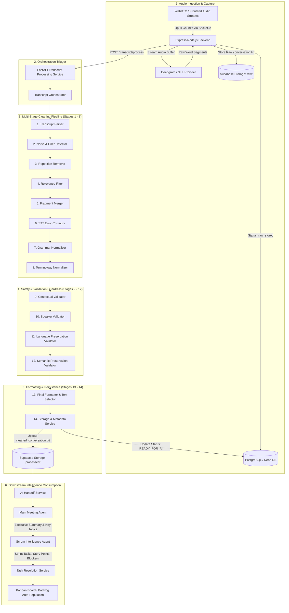
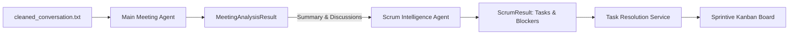
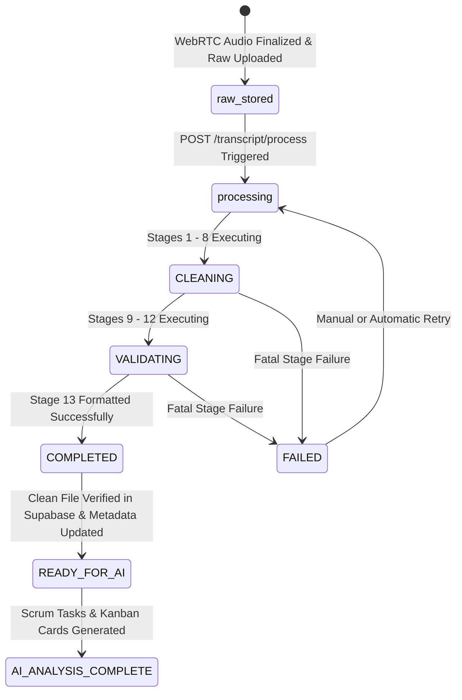

# Sprintive Transcript Processing Pipeline Architecture

> **Comprehensive Technical Guide & Stage-by-Stage Specification**  
> *Transforming raw, noisy, multilingual meeting audio transcripts into deterministic, structured, and hallucination-free inputs for AI Scrum Intelligence.*

---

## Table of Contents
1. [Executive Summary & System Vision](#1-executive-summary--system-vision)
2. [End-to-End System Architecture](#2-end-to-end-system-architecture)
3. [Core Design Principles & Philosophy](#3-core-design-principles--philosophy)
4. [The 15-Stage Pipeline: Detailed Stage-by-Stage Breakdown](#4-the-15-stage-pipeline-detailed-stage-by-stage-breakdown)
   - [Stage 1: Transcript Ingestion & Parsing (Foundation)](#stage-1-transcript-ingestion--parsing-foundation)
   - [Stage 2: Noise & Filler Word Detection (Classification)](#stage-2-noise--filler-word-detection-classification)
   - [Stage 3: Repetition & Stutter Removal (Deduplication)](#stage-3-repetition--stutter-removal-deduplication)
   - [Stage 4: Pre-Meeting & Irrelevant Content Filtering](#stage-4-pre-meeting--irrelevant-content-filtering)
   - [Stage 5: Sentence Segmentation & Fragment Merging](#stage-5-sentence-segmentation--fragment-merging)
   - [Stage 6: Speech-to-Text (STT) Error Correction](#stage-6-speech-to-text-stt-error-correction)
   - [Stage 7: Grammar & Punctuation Normalization](#stage-7-grammar--punctuation-normalization)
   - [Stage 8: Technical Terminology Normalization](#stage-8-technical-terminology-normalization)
   - [Stage 9: Contextual Consistency Validation](#stage-9-contextual-consistency-validation)
   - [Stage 10: Speaker Attribution Validation](#stage-10-speaker-attribution-validation)
   - [Stage 11: Language Preservation Validation](#stage-11-language-preservation-validation)
   - [Stage 12: Semantic Preservation Validation](#stage-12-semantic-preservation-validation)
   - [Stage 13: Final Presentation Formatting & Text Selection](#stage-13-final-presentation-formatting--text-selection)
   - [Stage 14: Storage & Processing Metadata Persistence](#stage-14-storage--processing-metadata-persistence)
   - [Stage 15: Pipeline Orchestrator & Concurrency Guard](#stage-15-pipeline-orchestrator--concurrency-guard)
5. [Downstream AI Handoff & Intelligence Agents](#5-downstream-ai-handoff--intelligence-agents)
6. [Complete Lifecycle State Machine](#6-complete-lifecycle-state-machine)
7. [End-to-End Concrete Example: Raw Audio to Sprint Tickets](#7-end-to-end-concrete-example-raw-audio-to-sprint-tickets)
8. [Summary Matrix: What Each Stage Solves](#8-summary-matrix-what-each-stage-solves)

---

## 1. Executive Summary & System Vision

Modern agile software teams rely on daily standups, sprint planning, and backlog refinement meetings to coordinate engineering velocity. However, raw speech-to-text (STT) outputs from WebRTC meetings are notoriously chaotic:
- Spoken dialogue is littered with acoustic artifacts, audio dropouts, and verbal crutches (`"um"`, `"uh"`, `"[cough]"`).
- Global engineering teams routinely code-switch between English and native languages (e.g. Hindi, Spanish, Hinglish like `"हाँ backend ready है"`).
- Technical jargon is misrecognized phonetically by speech engines (`"post gre SQL"` for PostgreSQL, `"date abase"` for database, `"cubes net ease"` for Kubernetes).
- Small talk and mic checks pollute the first 5–10 minutes of recordings.
- STT voice-activity splitters chop sentences into isolated fragments across artificial speaker boundaries.

If fed directly into Large Language Models (LLMs), these flaws cause hallucinated sprint tasks, missed blockers, incorrect task ownership, and corrupted technical requirements.

**The Sprintive Transcript Processing Service** is an enterprise-grade, 15-stage deterministic and AI-assisted pipeline. It sanitizes, normalizes, and validates meeting dialogue while enforcing mathematical guarantees on semantic fidelity, multilingual preservation, and data immutability before handing off transcripts to downstream Scrum Agents.

---

## 2. End-to-End System Architecture



---

## 3. Core Design Principles & Philosophy

### 1. Immutability of Raw Data
The original meeting transcript (`meetings/{meeting_id}/raw/conversation.txt`) is **strictly read-only and immutable**. It is never overwritten, truncated, or modified. All cleaning and formatting produces an independent, versioned artifact (`meetings/{meeting_id}/processed/cleaned_conversation.txt`).

### 2. Detect First, Clean Later
A detector must never unilaterally mutate or delete text. For example, Stage 2 identifies fillers and noise with a classification score without deleting words. This prevents premature loss of critical short affirmations such as `"yes"`, `"no"`, `"done"`, or `"fine"`.

### 3. Traceability & Lineage Preservation
Every segment maintains lineage tracking:
- `sequence`: Current sequential ID.
- `source_sequences`: Array of all raw original segment IDs consolidated into this utterance.
- `modifications`: Granular logs recording which stage altered the text, what changed, the error classification, and confidence.

### 4. Zero Unauthorized Translation
Sprintive does not forcibly translate native Indian languages (Hindi, Gujarati) or international speech (Spanish) into English. Code-switching (Hinglish/Spanglish) is a natural pattern for global tech teams. The system standardizes technical English terms while preserving native grammar and syntax.

### 5. Semantic Preservation & Negation Invariance
No cleaning operation is permitted to alter truth values, negations, quantities, assignees, dates, or technical decisions. If an upstream normalization inadvertently inverts meaning (e.g. changing `"API is not ready"` into `"API is ready"`), downstream validators detect the violation and cleanly revert to the verbatim raw text.

### 6. Resilient Fallbacks (Fail-Soft Architecture)
If external LLM services experience network timeouts, rate limits, or parse errors, the pipeline does not fail catastrophically. Every stage contains deterministic heuristics and regex fallbacks that allow the pipeline to proceed safely with non-blocking diagnostic warnings.

---

## 4. The 15-Stage Pipeline: Detailed Stage-by-Stage Breakdown

```text
 ┌────────┐    ┌────────┐    ┌────────────┐    ┌───────────┐    ┌────────┐
 │ 1.Parse│ ─► │ 2.Noise│ ─► │3.Repetition│ ─► │4.Relevance│ ─► │5.Merge │
 └────────┘    └────────┘    └────────────┘    └───────────┘    └────────┘
                                                                     │
 ┌───────────┐    ┌───────────┐    ┌───────────┐                     │
 │8.TermNorm │ ◄─ │ 7.Grammar │ ◄─ │   6.STT   │ ◄───────────────────┘
 └───────────┘    └───────────┘    └───────────┘
       │
       ▼
 ┌───────────┐    ┌───────────┐    ┌────────────┐    ┌────────────┐
 │ 9.Context │ ─► │10.Speaker │ ─► │11.Language │ ─► │12.Semantic │
 └───────────┘    └───────────┘    └────────────┘    └────────────┘
                                                           │
 ┌───────────┐    ┌───────────┐    ┌──────────────┐        │
 │15.Orchest.│ ◄─ │ 14.Store  │ ◄─ │  13.Format   │ ◄──────┘
 └───────────┘    └───────────┘    └──────────────┘
```

---

### Stage 1: Transcript Ingestion & Parsing (Foundation)
- **Primary Source File**: `app/services/transcript_parser.py`
- **Stage ID**: `parse`

#### Objective & Implementation
Reads the raw meeting transcript stream or file from object storage, validates UTF-8 encoding, and parses text into discrete, strongly-typed `TranscriptSegment` models using the first delimiter (`:`) to separate speaker names from spoken utterances.

#### Why This Stage Is Useful
Speech transcripts dumped by audio recorders or transcription servers are raw, unstructured strings. Stage 1 establishes order, guarantees Unicode safety across Asian and Latin alphabets, enforces chronological sequence indices, and tags unparseable lines as `UNKNOWN` without discarding valuable data.

#### Failure Scenario Without It
Downstream tools would have to parse arbitrary text strings with regex, causing crashes on multi-line utterances, unescaped colons (e.g. `Sarthak: The time is 10:30 AM`), or non-Latin speaker names.

---

### Stage 2: Noise & Filler Word Detection (Classification)
- **Primary Source File**: `app/services/noise_detector.py`
- **Stage ID**: `noise`

#### Objective & Implementation
Inspects each segment against multilingual dictionaries (`fillers.py`) and audio-artifact regular expressions. Classifies segments into:
- `CLEAN` (Confidence: 0.90–0.99)
- `FILLER` (`"um"`, `"uh"`, `"हम्म"`, `"eh"`, `"yeah"`, Confidence: 0.95–0.97)
- `NOISE` (`"[Background typing noise]"`, `"[cough]"`, `"--"`, Confidence: 0.98–1.00)
- `POSSIBLE_REPETITION` (Confidence: 0.90–0.95)
- `UNCERTAIN` (Confidence: 0.50–0.65)

#### Why This Stage Is Useful
Speech contains continuous non-lexical sounds that pollute LLM context windows. By identifying noise patterns early with deterministic scores, downstream stages know exactly which words can be safely pruned and which words must be guarded.

#### Key Innovation: Context-Aware Affirmation Guard
Standalone affirmations (`"yes"`, `"no"`, `"okay"`, `"done"`, `"ready"`) are protected as `CLEAN`. However, if the same speaker utters `"Okay."` three times consecutively, the second and third occurrences are classified as `POSSIBLE_REPETITION`.

---

### Stage 3: Repetition & Stutter Removal (Deduplication)
- **Primary Source File**: `app/services/repetition_remover.py`
- **Stage ID**: `repetition`

#### Objective & Implementation
Removes intra-segment token stutters (e.g. `"I I I have finished the test"`, `"ready ready"`) and prunes consecutive duplicate acknowledgements.

#### Why This Stage Is Useful
Audio stutter, nervous pauses, and packet drops produce repeated words that distort AI sentiment analysis and waste prompt tokens. Cleaning stutters ensures smooth, readable sentences.

#### Safety Guardrail
Repetitions representing deliberate counts or emphasis (e.g. `"The test ran 3, 3 times"`) are preserved using syntactic boundary checks.

---

### Stage 4: Pre-Meeting & Irrelevant Content Filtering
- **Primary Source File**: `app/services/relevance_filter.py`
- **Stage ID**: `relevance`

#### Objective & Implementation
Applies heuristic classifiers and contextual heuristics to segment dialogue into **Meeting Agenda Content** vs. **Pre-meeting Chit-Chat / Connectivity Checks**. Flags segments with `include_in_meeting: false` for utterances such as:
- *"Can you hear me?" / "Am I audible?"*
- *"Let me share my screen, hold on."*
- *"Did you watch the match yesterday?"*

#### Why This Stage Is Useful
Software engineers typically spend the first 3 to 8 minutes of a standup testing audio and talking about the weather. If this content reaches the Scrum Agent, the AI frequently hallucinates tasks like *"Investigate microphone connectivity issues for Alice"* or *"Follow up on weekend sports events"*.

#### Non-Destructive Filtering
Segments marked `include_in_meeting: false` are **never deleted**. They remain in the raw database record for auditing, compliance, and user replay, but are bypassed by downstream Scrum prompt generators.

---

### Stage 5: Sentence Segmentation & Fragment Merging
- **Primary Source File**: `app/services/fragment_merger.py`
- **Stage ID**: `merge`

#### Objective & Implementation
Reconstructs fragmented dialogue where a single continuous sentence from a speaker was split into multiple sub-segments due to acoustic Voice Activity Detection (VAD) silence pauses.
- *Input Segment 1*: `Sarthak: We need to connect the database...`
- *Input Segment 2*: `Sarthak: ...with PostgreSQL before deploying.`
- *Merged Output*: `Sarthak: We need to connect the database with PostgreSQL before deploying.`

#### Why This Stage Is Useful
Real-time STT software creates separate segments every time a speaker pauses for 400 milliseconds to think. Fragmented sentences break NLP syntactic dependency parsers and mislead LLMs into treating incomplete clauses as separate standalone thoughts.

#### Lineage Tracking
Maintains `source_sequences: [1, 2]`, allowing complete auditability back to the original timestamps and raw transcript lines.

---

### Stage 6: Speech-to-Text (STT) Error Correction
- **Primary Source File**: `app/services/stt_corrector.py`
- **Stage ID**: `stt`

#### Objective & Implementation
Leverages acoustic phonetic matching and structured LLM prompts (`prompts/stt_correction.py`) to heal misrecognized words caused by background noise, microphone distortion, or regional accents.
- `"date abase"` &rarr; `"database"`
- `"doc car"` &rarr; `"Docker"`
- `"get hub"` &rarr; `"GitHub"`
- `"cubes net ease"` &rarr; `"Kubernetes"`

#### Why This Stage Is Useful
Phonetic misrecognitions destroy technical meaning. If an engineer says *"The database is failing"*, but STT records *"The date abase is failing"*, an AI agent cannot map the statement to database infrastructure.

#### Traceability Fields
Decorates segment with:
- `stt_corrected_text`: Healed string.
- `stt_modified`: `true | false`.
- `stt_confidence`: `0.0 - 1.0`.
- `stt_error_type`: e.g. `TECHNICAL_TERM_MISRECOGNITION`.
- `stt_reason`: Detailed explanation of the phonetic correction.

---

### Stage 7: Grammar & Punctuation Normalization
- **Primary Source File**: `app/services/grammar_normalizer.py`
- **Stage ID**: `grammar`

#### Objective & Implementation
Restores punctuation (periods, commas, question marks), capitalizes sentence beginnings, and resolves minor spoken disfluencies without altering conversational tone, word order, or speaker intent.

#### Why This Stage Is Useful
Spoken speech lacks punctuation. Without periods and question marks, question-answer relationships collapse, and negative polarity boundaries become ambiguous. For instance, *"we cannot ship tomorrow is better"* could mean *"We cannot ship. Tomorrow is better"* OR *"We cannot ship tomorrow. Is better?"*. Stage 7 establishes clear syntactic boundaries.

---

### Stage 8: Technical Terminology Normalization
- **Primary Source File**: `app/services/terminology_normalizer.py`
- **Stage ID**: `terminology`

#### Objective & Implementation
Standardizes software engineering terms into official canonical orthography and casing using a high-performance deterministic dictionary (`core/terms.py`) supplemented by contextual validation:
- `"post gre SQL"` / `"postgres"` &rarr; `PostgreSQL`
- `"fast api"` &rarr; `FastAPI`
- `"node js"` &rarr; `Node.js`
- `"nextjs"` / `"next js"` &rarr; `Next.js`
- `"web rtc"` &rarr; `WebRTC`
- `"supa base"` &rarr; `Supabase`

#### Why This Stage Is Useful
Inconsistent naming breaks automated ticket indexing, GitHub label creation, and technical entity searches. Normalizing to official conventions ensures seamless integration with external developer tools.

#### Protection Rules
Code identifiers (`getUserAPI()`), URL endpoints (`/api/v1/auth`), and database column names (`user_id`) are protected from accidental alteration.

---

### Stage 9: Contextual Consistency Validation
- **Primary Source File**: `app/services/contextual_validator.py`
- **Stage ID**: `context`

#### Objective & Implementation
Analyzes adjacent utterances within a sliding window ($\pm 3$ segments) to verify that normalized statements remain logically and technically coherent with the ongoing discussion.
- Adheres strictly to: **CHECK &rarr; FLAG &rarr; PRESERVE**.
- Under no circumstances is transcript text rewritten during this stage.

#### Why This Stage Is Useful
If an engineer working on backend infrastructure says *"Let's check the React database"*, Stage 9 flags `POSSIBLE_INCONSISTENCY` (`TECHNICAL_CONTEXT_MISMATCH`). By flagging rather than silently rewriting, it allows humans and downstream agents to recognize anomalies without fabricating words the user never spoke.

---

### Stage 10: Speaker Attribution Validation
- **Primary Source File**: `app/services/speaker_validator.py`
- **Stage ID**: `speaker`

#### Objective & Implementation
Validates whether dialogue is plausibly attributed to the labeled speaker based on conversational turn-taking, vocative addresses (*"Harshit, what is your status?"*), and sentence continuations.
- Protocol: **VALIDATE &rarr; FLAG &rarr; SUGGEST &rarr; PRESERVE ORIGINAL SPEAKER**.
- Original speaker label is never overwritten automatically.

#### Why This Stage Is Useful
In multi-party WebRTC calls, network latency or microphone bleed often causes the STT diarization engine to assign one speaker's words to another participant. Stage 10 catches these errors, assigning `POSSIBLE_MISATTRIBUTION` and generating a `suggested_speaker` for human verification or weighted downstream analysis.

---

### Stage 11: Language Preservation Validation
- **Primary Source File**: `app/services/language_validator.py`
- **Stage ID**: `language`

#### Objective & Implementation
Verifies that upstream normalization stages did not accidentally translate non-English dialogue or corrupt multilingual code-switching.
- Example: `Harshit: "हाँ बोल, database connection check कर."`
- Evaluates script consistency (Devanagari, Latin, Cyrillic) and token-level language signatures.
- If upstream processing erroneously translated this to `"Yes speak, check database connection"`, the validator flags `LANGUAGE_CHANGED` (`UNEXPECTED_TRANSLATION`).

#### Why This Stage Is Useful
LLMs have a strong tendency to translate foreign phrases into English during summarization or rewriting. In global software development, non-English phrasing often carries nuanced emotional tone, colloquial context, or company-specific slang. Stage 11 acts as a strict firewall guarding native linguistic expression.

---

### Stage 12: Semantic Preservation Validation
- **Primary Source File**: `app/services/semantic_validator.py`
- **Stage ID**: `semantic`

#### Objective & Implementation
The ultimate safety guardrail against hallucination and meaning drift. Utilizes a dual-tier verification engine:
1. **Deterministic Rule Engine** (`semantic_rules.py` + `entity_extractor.py`): High-precision regex analysis of negations (`not`, `never`, `no`), numbers, quantities, dates, deadlines, and technical entities.
2. **LLM Semantic Engine** (`prompts/semantic_validation.py`): Pydantic-structured LLM validation evaluating causal relationships and commitment semantics.

#### Why This Stage Is Useful
If an STT corrector or grammar normalizer alters even a single word—such as dropping a negation (*"The deployment did not fail"* &rarr; *"The deployment did fail"*) or altering a metric (*"3 open bugs"* &rarr; *"5 open bugs"*—the entire sprint planning session is corrupted.

#### Automated Rejection & Recovery
If `semantic_status == SEMANTICALLY_CHANGED`, Stage 13 automatically rejects the cleaned candidate and safely falls back to the original raw text.

---

### Stage 13: Final Presentation Formatting & Text Selection
- **Primary Source File**: `app/services/transcript_formatter.py`
- **Stage ID**: `format`

#### Objective & Implementation
Deterministic presentation layer that constructs the final AI-ready transcript artifact:
- **Hierarchical Text Selection**: Evaluates the safest text candidate:
  $$\text{terminology\_normalized\_text} \longrightarrow \text{grammar\_corrected\_text} \longrightarrow \text{stt\_corrected\_text} \longrightarrow \text{processed\_text} \longrightarrow \text{text}$$
- **Safety Policy Enforcement**: Reverts to original raw text if Stage 11 (`LANGUAGE_CHANGED`) or Stage 12 (`SEMANTICALLY_CHANGED`) raised an error.
- **Noise & Metadata Stripping**: Excludes segments where `include_in_meeting == false` and strips dozens of internal diagnostic boolean flags.
- **Serialization**: Formats clean, double-newline delimited dialogue blocks (`Speaker: Utterance`) encoded in strict UTF-8.

#### Why This Stage Is Useful
Downstream AI Scrum Agents require compact, clean, token-efficient text. Passing raw JSON objects bloated with 40 internal validation fields wastes LLM context windows and increases API latency and costs.

---

### Stage 14: Storage & Processing Metadata Persistence
- **Primary Source File**: `app/services/storage_service.py`
- **Stage ID**: `store`

#### Objective & Implementation
Persists the validated transcript and updates database lifecycle states:
1. Encodes final transcript as UTF-8 (`text/plain; charset=utf-8`).
2. Uploads cleaned artifact to canonical Supabase Storage path:
   `meetings/{meeting_id}/processed/cleaned_conversation.txt`
3. Verifies file presence in storage bucket.
4. Idempotently updates PostgreSQL/Neon metadata (`cleaning_duration_ms`, `cleaner_version: 1.0.0`, `metrics`).
5. Atomically promotes status to **`READY_FOR_AI`**.

#### Why This Stage Is Useful
Separates raw historical records from production-ready AI inputs. Ensures that downstream AI services are only triggered once the cleaned file is verified on disk/object storage.

---

### Stage 15: Pipeline Orchestrator & Concurrency Guard
- **Primary Source File**: `app/services/transcript_orchestrator.py`
- **Stage ID**: `orchestrator`

#### Objective & Implementation
Central workflow coordinator executing Stages 1 through 14 with state tracking, error handling, and concurrency management:
- **Concurrency Guard**: Atomic database status checking prevents duplicate simultaneous processing of the same meeting (returns HTTP 409 Conflict if already in flight).
- **Execution Modes**: Supports synchronous execution (blocking API call) and asynchronous execution (FastAPI background tasks).
- **Comprehensive Observability**: Emits detailed stage durations, segment classification ratios, and non-blocking warning arrays.

---

## 5. Downstream AI Handoff & Intelligence Agents

Once the transcript processing service marks the meeting status as **`READY_FOR_AI`**, the Express backend and Python AI pipeline execute downstream Scrum intelligence:



### 1. Main Meeting Agent (`meeting_agent.py`)
- Analyzes high-level meeting trajectory.
- Generates executive summaries, key decisions made, and sentiment metrics.
- Identifies open discussion topics.

### 2. Scrum Intelligence Agent (`scrum_agent.py`)
- Ingests cleaned dialogue and meeting analysis.
- Extracts actionable sprint tasks conforming to Agile standards:
  - `title`: Imperative action item (e.g. *"Fix PostgreSQL Connection Pooling"*).
  - `description`: Detailed technical acceptance criteria.
  - `priority`: `LOW | MEDIUM | HIGH | URGENT`.
  - `story_points`: Fibonacci estimation (1, 2, 3, 5, 8).
  - `assignee`: Speaker or team member referenced in dialogue.
  - `blockers`: Active impediments identified during the standup.

### 3. Task Resolution Service (`task_resolution_service.py`)
- Performs entity resolution against existing project backlog tickets in the database.
- Detects if an item discussed is a **New Task**, an **Update to an Existing Ticket**, or a **Resolved Blocker**.
- Automatically creates or updates Kanban cards.

---

## 6. Complete Lifecycle State Machine

The meeting transcript advances through six deterministic states:



---

## 7. End-to-End Concrete Example: Raw Audio to Sprint Tickets

### Step 1: Raw Spoken Dialogue (Input to Stage 1)
```text
Sarthak: Can you hear me? Audio check, one two.
Harshit: Yes, loud and clear.
Sarthak: Okay, let's start today's standup.
Harshit: um... I was working on the post gre SQL migration...
Harshit: ...and I have one issue with the date abase connection.
Harshit: The API is not connecting.
Harshit: ready ready.
UNKNOWN: [Background typing noise and low hum]
Harshit: हाँ बोल, database connection check कर लेना.
Sarthak: Got it. I will fix the connection pool configuration today.
```

---

### Step 2: Evolution Through Key Pipeline Stages

| Pipeline Stage | Input Text Sample | Processed Output | Applied Transformation |
| :--- | :--- | :--- | :--- |
| **Stage 2: Noise Detection** | `"[Background typing noise]"` | `classification: NOISE` (0.98) | Flagged as non-lexical audio noise. |
| **Stage 3: Repetition** | `"ready ready."` | `""` (Pruned) | Removed duplicate stutter tokens. |
| **Stage 4: Relevance** | `"Can you hear me? Audio check..."` | `include_in_meeting: false` | Classified as pre-meeting audio check. Excluded from AI prompts. |
| **Stage 5: Fragment Merger** | Utterances split across 2 segments | `"I was working on the post gre SQL migration and I have one issue..."` | Stitched into a single coherent sentence with `source_sequences: [4, 5]`. |
| **Stage 6: STT Correction** | `"...date abase connection."` | `"...database connection."` | Phonetic healing: `"date abase"` &rarr; `"database"` (Confidence: 0.96). |
| **Stage 7: Grammar** | `"um i was working on..."` | `"I was working on..."` | Stripped filler `"um"`, capitalized pronoun, added terminal punctuation. |
| **Stage 8: Terminology** | `"post gre SQL migration"` | `"PostgreSQL migration"` | Canonical technical casing standardizer applied. |
| **Stage 11: Language** | `"हाँ बोल, database connection check कर लेना."` | `PRESERVED` (Confidence: 0.98) | Protected Devanagari script; prevented unauthorized translation into English. |
| **Stage 12: Semantics** | `"The API is not connecting."` | `SEMANTICALLY_PRESERVED` | Verified negation (`"not"`) was untouched. Zero factual drift. |

---

### Step 3: Final Formatted Artifact (`cleaned_conversation.txt`)
```text
Sarthak Talaviya: Okay, let's start today's standup.

Harshit Pambhar: I was working on the PostgreSQL migration and I have one issue with the database connection. The API is not connecting.

Harshit Pambhar: हाँ बोल, database connection check कर लेना.

Sarthak Talaviya: Got it. I will fix the connection pool configuration today.
```

---

### Step 4: Downstream Scrum Intelligence Output (Automated Kanban Card)
```json
{
  "tasks": [
    {
      "title": "Fix PostgreSQL Connection Pool Configuration",
      "description": "Resolve API database connection failure encountered during PostgreSQL migration. Investigate and update connection pool settings.",
      "priority": "HIGH",
      "story_points": 3,
      "assignee": "Sarthak Talaviya",
      "blockers": [
        "API cannot establish connection to the database"
      ],
      "status": "TODO",
      "source_evidence": "Sarthak Talaviya: Got it. I will fix the connection pool configuration today."
    }
  ]
}
```

---

## 8. Summary Matrix: What Each Stage Solves

| Stage # | Stage Name | Category | Primary Failure Solved |
| :---: | :--- | :--- | :--- |
| **1** | **Transcript Parser** | Ingestion | Eliminates unparsed strings, missing timestamps, and encoding corruption. |
| **2** | **Noise Detector** | Classification | Distinguishes meaningful speech from verbal fillers (`"um"`, `"uh"`) and background audio artifacts. |
| **3** | **Repetition Remover** | Cleaning | Prevents token waste, stutter loops, and misleading sentiment emphasis caused by repeated words. |
| **4** | **Relevance Filter** | Scoping | Stops pre-meeting mic checks and small talk from generating false sprint tickets. |
| **5** | **Fragment Merger** | Reconstruction | Solves choppy, broken sentences caused by speech-to-text silence detectors. |
| **6** | **STT Corrector** | Acoustic Healing | Replaces phonetically garbled words (`"date abase"`) with actual technical terms (`"database"`). |
| **7** | **Grammar Normalizer** | Syntax | Adds sentence boundaries and capitalization so NLP engines parse clauses accurately. |
| **8** | **Terminology Normalizer** | Standardization | Enforces canonical software naming (`PostgreSQL`, `FastAPI`, `WebRTC`) for developer tooling. |
| **9** | **Context Validator** | Logical Guard | Flags technical domain mismatches without corrupting the speaker's true words. |
| **10** | **Speaker Validator** | Attribution Guard | Detects speaker misattribution caused by audio bleed and network latency. |
| **11** | **Language Validator** | Linguistic Guard | Prevents LLMs from translating native Indian or international languages into English. |
| **12** | **Semantic Validator** | Truth Guard | Guarantees that no cleaning stage alters numbers, negations, commitments, or deadlines. |
| **13** | **Final Formatter** | Presentation | Strips internal metadata and formats compact, token-efficient text for AI agents. |
| **14** | **Storage & Metadata** | Persistence | Guarantees raw data immutability, UTF-8 storage, and atomic metadata state transitions. |
| **15** | **Orchestrator** | Coordination | Manages concurrency locks, retries, stage timeouts, and async background execution. |

---

*Authored for the Sprintive Engineering Team.*  
*Service Location: `transcript-processing-service/` | Backend Coordinator: `backend/src/services/transcript/`*
